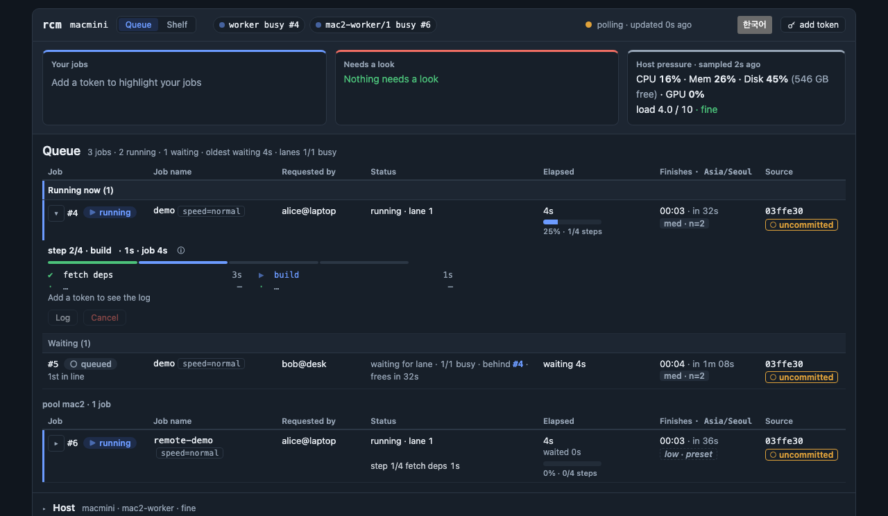

<h1 align="center">remote_ci_monitor</h1>

<p align="center">
  <b>Your team already owns a build machine. This turns it into a CI queue.</b><br>
  Submit a preset from any computer, watch the queue, get an exit code back.
</p>

<p align="center">
  <a href="https://github.com/monocsp/remote_ci_monitor/actions/workflows/ci.yml"></a>
  <a href="https://github.com/monocsp/remote_ci_monitor/releases/latest"></a>
  
  
  <a href="LICENSE"></a>
</p>

<p align="center">
  <a href="#install">Install</a> ·
  <a href="#first-run-pick-a-role-and-set-it-up">First run</a> ·
  <a href="docs/usage.md#a-test-install-next-to-one-that-runs">Test install</a> ·
  <a href="#build-machine-3-commands">Quick start</a> ·
  <a href="docs/usage.md">Usage guide</a> ·
  <a href="docs/configuration.md">Configuration</a> ·
  <a href="CHANGELOG.md">Changelog</a><br>
  <b>English</b> · <a href="README.ko.md">한국어</a>
</p>

<p align="center">
  
</p>

A team that shares **one build machine** ends up queueing by hand: who is running what, is it stuck
or just slow, is the machine on fire, did it pass? rcm answers that in one screen and one exit code.

- **Nothing else to run.** One package, zero runtime dependencies, Python 3.11+ standard library
  only — the same package is the server and the client. No GitHub, no broker, no database server.
- **Your tree, not your last push.** `rcm run` uploads the working directory as it is, uncommitted
  changes included, so a green result means *this* tree passed. Deploy presets run a pushed ref
  instead.
- **It says when it does not know.** Exit code 3 is *unknown* (server restarted, unreachable,
  timed out) and is never dressed up as a failure. ETAs carry their confidence; missing numbers
  print as `—`, not `0`.
- **The files come back.** A preset can declare what it produces
  (`artifacts = ["test/**/goldens/*.png"]`); `rcm run --fetch-artifacts` writes those files into the
  same paths in your tree. A file you edited while waiting is never overwritten.
- **Finds itself on the LAN.** Sessions on the same network need no address at all: the server
  advertises `_rcm._tcp` over mDNS/DNS-SD. Elsewhere any route works (Tailscale, a tunnel).
- **A web page for the people watching.** Static, no build step, no third-party assets, readable on
  a phone.

Build machines run macOS (Apple Silicon or Intel) and Linux. Windows is out of scope; sessions on
Windows submit through WSL ([Windows (WSL)](docs/usage.md#windows-wsl)).

Status: **v0.11.1, M5t-a released; M5t-b and M5t-c next**. There is no GitHub backend and none is planned. `PLAN.md`
(Korean) is the plan of record; `CHANGELOG.md` is what changed.

## Install

Needs Python **3.11.4+** (the safe `tarfile` filter) on both machines. One package, no runtime
dependencies:

```sh
pipx install git+https://github.com/monocsp/remote_ci_monitor   # from git (main); add @dev for the dev branch
pipx install remote-ci-monitor                      # from PyPI (not published yet — see CONTRIBUTING.md)
uvx --from remote-ci-monitor rcm version            # or run it through uv without installing
```

No `pipx` yet? `python3 -m pip install --user pipx && python3 -m pipx ensurepath`, then open a new
shell. Distributions that follow PEP 668 (Ubuntu 23.04+, Debian 12+, and Ubuntu in WSL) refuse that
`pip` line; there, use `sudo apt install pipx && pipx ensurepath`. If `rcm` is "command not found"
right after installing, `~/.local/bin` is not on your `PATH` yet — run `pipx ensurepath` and open a
new shell. A release wheel from the GitHub Releases page also installs with
`pipx install <wheel-url>`.

## First run: pick a role and set it up

Every machine that uses rcm has a role. `rcm setup` writes the files for one:

| role | the machine | what `rcm setup` writes |
|---|---|---|
| `client` | sends jobs and reads the results — your laptop | `client.toml` |
| `worker` | runs the jobs a coordinator hands it | `worker.toml` and a worker service file |
| `coordinator` | keeps the queue and hands jobs to workers; runs none itself (`lanes = 0`) | `server.toml` and a server service file |
| `coordinator-worker` | keeps the queue and runs jobs too — one machine does everything | `server.toml` (`lanes = 1`) and a server service file |

**If this machine already runs rcm as a service**, read
[a test install next to one that runs](docs/usage.md#a-test-install-next-to-one-that-runs) first:
`rcm setup` refuses the running install's files, and a test install gets its own port, label,
config and data folder.

On a fresh machine the shortest path makes it a `coordinator-worker` and a `client` at once. setup
registers nothing and starts nothing: the lines it prints under `next —` install and start the
service, and the first line under `tokens —` makes the token.

```sh
rcm setup --role coordinator-worker --bind 127.0.0.1 --yes   # server.toml and a service file
# run the lines it printed under `next —` (the service), then the first line under `tokens —` (the token)
rcm setup --role client --server http://127.0.0.1:8787 --yes
export RCM_TOKEN=<the token>                                 # the one that tokens line printed
rcm doctor --role coordinator-worker && rcm check
rcm run ok                                                   # exit 0 and one JSON line
```

Each step explained, adding workers and clients, a coordinator that runs nothing, `local_only`,
and undo and uninstall are in the usage guide's
[Getting started](docs/usage.md#getting-started-pick-a-role-and-set-it-up).

## Build machine (3 commands)

**If this machine already runs rcm as a service, do not run these commands.** They use the default
`~/.config/rcm/server.toml` and data folder, and an rcm other than the service's migrates the
database it opens. Follow
[a test install next to one that runs](docs/usage.md#a-test-install-next-to-one-that-runs)
instead.

Without `rcm setup` and without a service, in one terminal:

<!-- every `rcm …` line between smoke:begin and smoke:end is executed by scripts/smoke_install.sh — keep them in sync -->
<!-- smoke:begin -->
```sh
rcm init server            # writes ~/.config/rcm/server.toml — edit presets and the bind address
rcm token add laptop       # prints the token ONCE; hand it to that session machine
rcm serve                  # http://127.0.0.1:8787 · Ctrl-C or SIGTERM stops it cleanly
```
<!-- smoke:end -->

The generated config ships a harmless `ok` preset, so you can prove the path end to end before
writing your own. To accept sessions from other computers set `bind` to the machine's LAN or
Tailscale address (or `0.0.0.0`) and, on macOS, allow Python through the firewall prompt; check
from another computer with `curl http://<build-machine>:8787/api/health`. A server bound off
loopback also **advertises itself** on the network (`_rcm._tcp`, mDNS/DNS-SD — `advertise = false`
turns it off, `advertise_name` renames it), so sessions there need no address at all.

Tokens: `rcm token add ops --admin` makes an admin token (pause/resume, cancel any job, read any
log); `rcm token list` never shows secrets; `rcm token revoke NAME`. Another port:
`rcm serve --port 8790` (or `port = …` in the config). Set `public_url` when you bind to `0.0.0.0`
so the job URLs printed by `rcm run` open from other computers.

Keep it running across logins and reboots with the launchd and systemd examples in
[Operating the build machine](docs/operating.md#run-as-a-service).

**A second machine** joins as a worker that takes jobs from the same queue:
[more machines](docs/usage.md#more-machines),
[Second build machine](docs/configuration.md#second-build-machine-remote-worker) and
[Which machine runs a job](docs/configuration.md#which-machine-runs-a-job).

## Session machine (3 commands)

A session needs two things: **where** the server is, and **who you are**. Only the first one can
be automatic.

On the same Wi-Fi or LAN as the build machine, leave `server` empty (or `server = "auto"`) and rcm
finds it, which `rcm discover` shows. That needs rcm **0.2.2 or newer on both sides** — an older
client has no discovery and stops with `no server configured`, and unlike `rcm worker` it never
compares its version with the server's. From another network you need a route of your own —
Tailscale, or a tunnel — and then that address goes in `client.toml`.

The token is the other half, and it is deliberately manual. `rcm token add` runs **on the build
machine** and writes straight to the server's database; there is no API that hands a token out, and
there will not be one. So on a machine that has just found the server, `rcm check` showing a green
**server** row and a red **token** row is not a bug — copying the token over is the one step left.

<!-- smoke:begin -->
```sh
rcm init client --server http://<build-machine>:8787   # ~/.config/rcm/client.toml (mode 600)
export RCM_TOKEN=<token from rcm token add>            # or put it in that file as token = "…"
rcm check                  # python · server · token · presets · timezone must all say ok
cd ~/src/app               # any project directory — rcm run uploads the *current directory*
rcm run ok                 # first job: exit 0 and one JSON line means everything works
rcm top                    # queue, ETAs, recent results, host load
```
<!-- smoke:end -->

`rcm run` snapshots the **current directory** (git-tracked plus untracked-but-not-ignored files,
minus `.rcmignore` patterns), uploads only what the server does not already have, waits, and prints
one JSON line on stdout. Progress goes to stderr. Ctrl-C detaches: the job keeps running,
`rcm wait --job N` picks it back up and `rcm cancel N` stops it. The workspace on the build machine
has **no `.git`** — scripts that need history belong in a `git_ref` preset.

**New here? The [usage guide](docs/usage.md) walks through all of this with annotated
screenshots.**

## Running a gate from a session

A **gate** is the preset your build machine runs before a merge — analysis, tests and lint in one
script, usually with a `scope` input for a full or a quick pass. From the repository root:

```sh
rcm check                    # once: every row ok, and gate among the presets
rcm eta gate -f scope=full   # position, wait, duration and confidence; submits nothing
rcm run gate -f scope=full   # snapshot, join or submit, upload, wait; one JSON line on stdout
```

Branch on the exit code: 0 succeeded · 1 failed · 2 cancelled or timed out · 3 unknown, which is
never a failure ([Exit codes](#exit-codes)). `rcm logs N` and `rcm artifacts N --fetch` show why a
job was red, and `examples/session/ci-gate.sh` is a complete wrapper (needs `jq`). The whole loop
step by step, with detaching, cancelling, joining and faster scopes, is in the usage guide's
[a gate from start to finish](docs/usage.md#a-gate-from-start-to-finish).

**Keep the client current.** From 0.8.0 the installed `rcm` follows the server: when the
server runs another version, the next command downloads the server's own client, checks its
sha256 and runs it (`RCM_CLIENT_VERSION=installed` turns that off). Use
`examples/session/update-client.sh` for the first install and to upgrade the installed `rcm`
itself ([keeping clients on the server's version](docs/operating.md#keeping-clients-on-the-servers-version)).

## Session commands

| command | what it shows |
|---|---|
| `rcm run PRESET [-f k=v] [--ref REF] [--priority P] [--pool NAME] [--machine ID] [--no-cache] [--by LABEL] [--link URL [--link-label TEXT]] [--no-join] [--no-supersede] [--keep] [--at TIME \| --in DURATION] [--no-wait] [--exclude PATTERN] [--dir DIR] [--timeout S] [--poll]` | snapshot → submit (joins an identical active job) → upload (only changed files when the server caches) → wait. `--ref` for `git_ref` presets: no snapshot, the server fetches the ref. `--priority low\|normal\|high`; `--no-cache` uploads a full tarball; `--link` shows an http(s) page — its pull request, say — next to the job's name in the web UI ([job links](docs/configuration.md#linking-a-job-to-a-page)); `--no-join` never joins an identical job; `--no-supersede` keeps your older job of the same branch when the preset would clear it ([superseding](docs/configuration.md#superseding-older-jobs-of-the-same-branch)); `--keep` puts the job's artifacts on the [shelf](docs/configuration.md#keeping-a-jobs-files-the-shelf) and prints a link any browser on the network opens; `--at 15:00` or `--in 90m` hands the server a time instead and the job waits as `scheduled` ([running a job later](docs/configuration.md#running-a-job-later---at-and---in)); `--no-wait` returns as soon as the job is queued and prints its position and ETA; `--exclude` adds an `.rcmignore` pattern; `--dir` snapshots another directory; `--machine ID` pins the job to one machine (a check preset with any token, anything else admin) |
| `rcm wait --job N [--timeout S] [--poll]` | follows the job over the event stream, polls every 2 s if the stream is refused |
| `rcm eta PRESET [-f k=v] [--priority P] [--pool NAME] [--json]` / `rcm eta --job N` | queue position, jobs ahead, wait, expected duration, finish time and the confidence of that estimate; a job that is already running shows its state and elapsed time instead of a wait |
| `rcm top [--watch N] [--json]` | one screen: queue with reasons and ETAs, recent results, medians, host load (CPU · memory · disk · GPU · top processes) |
| `rcm jobs [--mine] [--state S] [--pool NAME] [--json]` | queued, running and recent jobs; `--mine` needs your token and includes jobs you joined |
| `rcm logs N [--follow]` | the job log (your jobs, jobs you joined, or any job with an admin token) |
| `rcm artifacts N [--fetch --output DIR] [--force] [--resume]` | what the job produced, and fetching it. `rcm run --fetch-artifacts` does it in one step, into the tree you submitted |
| `rcm keep N [--json]` | put a job on the [shelf](docs/configuration.md#keeping-a-jobs-files-the-shelf) while its bundle still exists (a running job goes on it when it finishes) and print the link |
| `rcm shelf [--state active\|stale\|all] [--preset P] [--json]` · `rcm shelf get N\|URL --output DIR` · `rcm shelf rm N` | what is on the shelf, with the day each item moves to cleanup pending; `get` downloads a kept job's files again, from any computer and without a token (`--latest PRESET`, `--file PATH`); `rm` removes one now (admin) |
| `rcm presets [--json]` | presets the server offers and their inputs |
| `rcm discover [--json] [--timeout S]` | rcm servers on this network (mDNS); `rcm check` says `(found on this network)` when it used one |
| `rcm machines [--json] [--machine ID]` | every machine that runs jobs: host, pool, lanes, its environment fingerprint (`xcode 27.2 · flutter 3.47.8`) and how many presets it can run, with the reasons for the rest. `--machine` shows one machine's verdict per preset and its checks ([machines](docs/configuration.md#which-machine-runs-a-job)) |
| `rcm recheck MACHINE [CHECK…]` | run a machine's check presets again after you fixed it (admin) |
| `rcm cancel N` · `rcm pause` · `rcm resume` | cancel (joiners only leave the join list) · pause/resume the queue (admin) |
| `rcm reload [--dry-run]` | re-read the config file and its `include` files — presets and repos only, no restart (admin); `--dry-run` names what would change and applies nothing |
| `rcm bump N [--priority high]` | change a waiting job's priority (admin) |
| `rcm release new [--repo R] [--ios X] [--android Y] [--yes]` · `list` · `delete N` · `open N` | store version drafts (admin). With no version arguments `new` asks only for the names, offering the server's hints: enter takes the hint, `-` skips that store, `--yes` takes both. `open` prints the address of the version page |
| `rcm release status [REPO] [--build-name X]` | both stores' review state: runs the repository's `status` role, waits, and prints each store's version, build, state and the store's own word (any client token) |
| `rcm release golive [REPO] --build-name X --platform ios\|android\|both --plan` · `… --confirm-build-number N [--at TIME \| --in DURATION]` | going live with an approved build ([going live](docs/configuration.md#going-live-golive)). `--plan` reads approval and the approved build and waits; without it you ask for the release now or at a time, with the approved build number you typed (admin). Nothing goes live on approval by itself |

Every estimate carries a `confidence`: `high` (median of ≥ 5 real runs), `med` (fewer), `low`
(a preset or default guess), `group wait` (blocked by a concurrency group) or `overdue`. Unknown
values print as `—`, never as `0`.

## Presets and step markers

The server only runs **presets** from its config. A session sends a preset name and inputs; inputs
arrive as `RCM_INPUT_<NAME>` environment variables, never spliced into a command line.

```toml
[[presets]]
name = "gate"
argv = ["bash", "scripts/gate.sh"]      # runs from the uploaded workspace root
pool = "default"                        # worker pool for this preset's jobs (default "default")
pools = []                              # extra pools a session may choose with --pool
timeout_seconds = 1200
expected_seconds = 480                  # used until enough real runs exist
[[presets.inputs]]
name = "scope"
type = "choice"
choices = ["full", "commit", "fast"]
default = "full"
```

Your script reports progress by printing markers at the start of a line:

```
::rcm::steps::3            # optional: total step count
::rcm::step::analyze       # a new step starts (the previous one ends)
::rcm::step-end::ok        # optional: "ok" or "fail"
::rcm::summary::all green  # optional: one-line result shown in the queue
::rcm::progress::41/68::inquiry_photo/android::run   # optional: progress inside the current step
::rcm::action::login::Sign in on the build machine   # optional: a person has to act
```

`::rcm::progress::<done>/<total>::<unit>::<state>[::<note>]` draws a bar inside a long step
from a denominator the script knows ([progress inside a step](docs/configuration.md#progress-inside-a-step)).
`::rcm::action::<code>::<note>` says the job cannot go on without a person — a sign-in expired,
say: the running row's reason becomes `needs_action`, `rcm wait` prints it on stderr, and
`rcm wait --return-on-action` returns with exit 4 while the job keeps running
([when a person has to act](docs/configuration.md#when-a-person-has-to-act)).

A session can send a job to another pool with `--pool`, but only to a pool the preset lists in
`pools`. Everything else the config can do — deploy presets that fetch a pushed ref, priorities,
the snapshot cache, remote workers, notifications, retention — is in
[Configuration](docs/configuration.md).

## Web UI

Open `http://<build-machine>:8787/` in any browser, phone included: three static files served by
`rcm serve`, no build step and no third-party assets. The first screen answers three questions at
a glance — **Your jobs** (paste your token with the key button), **Needs a look** (only actionable
causes, worst first) and **Host pressure** — and below them sit the queue with its status column
and ETA confidence, the jobs scheduled for later, the host card, recent results and how the
estimates were computed. A job that says it needs a person (`needs action · login · …`) is first
under **Needs a look**; the header counts failed notification hooks. A job that
has merely gone quiet is not listed as needing a look; see
[Configuration](docs/configuration.md#estimates-and-when-a-job-is-called-not-responding).

Updates arrive over the event stream; if it drops, the page polls every 10 s, and after 30 s
without a successful response a **Lost connection** banner appears while the ages keep counting.
The page never pretends to be current. `#/jobs/N` deep-links to a job.

When a repository in `server.toml` has a `[repos.<name>.release]` profile, the header gains a
**Queue | Store** switch and `#/store/<name>` opens the Store tab: a settings gate until its
secrets are verified, then a list of versions with a status screen and its review panel, a page
per draft with both stores' copy, and a sheet with the only **Submit for review** button. With a `status` preset the panel also shows each
store's review state, and **Check again** runs the preset once more. Nothing goes live on approval
by itself. Every screen of it is in the
[usage guide](docs/usage.md#the-store-tab-secrets-versions-and-drafts).

### Store tab — connecting a project's release flow

Beyond the queue, a repository can get a **Store tab**: fetch, store snapshot, gate, QA, upload,
submit for review, each a button over the project's *own* release scripts. rcm draws the JSON
those scripts write and runs the presets they declare; it never computes a build number or judges
QA. What a project must provide is written down in
[docs/release-contract.md](docs/release-contract.md); the fastest way to provide it is the skills
rcm ships for a Claude Code session in that project:

```sh
rcm skills list                                   # the skills packaged with this rcm
rcm skills install --into ~/src/app               # copies them to ~/src/app/.claude/skills/
# in that project, in Claude Code:
/rcm-connect                                      # asks project · repo name · platforms · optional tiers
```

The skills write only into the project and never touch the live server file, secrets or the
stores. The same install brings **`rcm-ci-connect`**, which runs a repository's CI on the build
machine and posts a `rcm/ci` commit status ([Configuration](docs/configuration.md#release-profile)).

## Exit codes

| `rcm wait` exit | meaning |
|---|---|
| 0 | job succeeded |
| 1 | job failed (see `summary`, plus `failed_step` when the script declared one and `last_step` otherwise), or a preset that [retries](docs/configuration.md#trying-again-later-presetsretry) still said "not yet" on its last attempt (`exhausted`) |
| 2 | cancelled, timed out, or a schedule that never started (`expired`) |
| 3 | **unknown**: lost after a server restart, server unreachable, or `--timeout` elapsed. Never treated as a failure. |
| 4 | only with `--return-on-action`: the job asked a person to act (`::rcm::action::`) and **keeps running**. Resume with `rcm wait --job N`. |

A `retried` attempt is not an end: `rcm wait` follows its `retried_as` to the next attempt and
exits with the last one's code ([trying again later](docs/configuration.md#trying-again-later-presetsretry)).

Usage errors and validation failures that never reach the server also exit 2, including `rcm run`
when the server cannot be reached before submit. So does a submission the server refuses for
certain without making a job — 400, 401, 403, 413, a 409 whose code is `schedule_exists`
or `release_route_required`, and a 409 `no_capable_machine` or `tool_missing` for a
[`local_only`](docs/configuration.md#keeping-a-preset-on-the-server-local_only) preset the
server's lanes cannot take; any other 409 is 3, since rcm cannot tell whether a job was made.
`rcm wait` gives an unreachable server 60 s to come back (printing `reconnecting…`) before
exiting 3; `rcm eta`, `rcm jobs` and `rcm top` fail fast with `cannot reach <url>` and exit 3.

## Security notes

- Every write (submit, upload, cancel) needs a bearer token, stored as a SHA-256 hash. Tokens have
  a kind: `client`, `admin` (cancel any job, pause, bump) and `worker` (`/worker/*` only).
- Only configured presets run. No shell interpolation. Uploads are extracted with Python's
  `tarfile` data filter — no absolute paths, no `..`, no links outside the workspace.
- Discovery answers carry only the server name, port, version, lane count and LAN addresses —
  never tokens, presets or paths. Anyone on the LAN can learn that a build server exists.
- The server binds to `127.0.0.1` unless you say otherwise, and it does **no TLS**: put it behind
  Tailscale or a TLS proxy. Reads are open on that network by default (`read_auth = "basic"`
  password-protects them), and job logs always need the job's token or an admin token.
- Run it as a dedicated OS user without sudo, and keep build secrets in files on the build machine
  that presets read — never send them in a job.

The full list, including what the web UI keeps in `localStorage`, is in
[Operating the build machine](docs/operating.md#security-notes).

## Documentation

| document | what is in it |
|---|---|
| [Usage guide](docs/usage.md) · [한국어](docs/usage.ko.md) | a first job, step by step, with annotated screenshots |
| [Release contract](docs/release-contract.md) | what a project provides for the Store tab: profile, presets by role, artifact files, markers, secrets, the driver, and the skills that generate them |
| [Configuration](docs/configuration.md) | presets, inputs, markers, deploy presets, priority, snapshot cache, pools and remote workers, which machine runs a job (probes, placement, checks), notifications, the client and worker files |
| [Operating the build machine](docs/operating.md) | running it as a service, Docker, upgrades, security, why a number can be wrong, the manual check on a real machine |
| [CHANGELOG.md](CHANGELOG.md) | every user-visible change, newest first |
| [CONTRIBUTING.md](CONTRIBUTING.md) | development, house rules, branches, releasing |
| `PLAN.md` (Korean) | the plan of record: scope, decisions, milestones |

## Contributing

Bug reports and pull requests are welcome. `main` and `dev` are protected: branch from `dev` and
open the pull request against `dev`. Run `ruff check . && pytest` before you push, keep runtime
dependencies at zero, and update the documentation in the same pull request. Details in
[CONTRIBUTING.md](CONTRIBUTING.md).

## License

[MIT](LICENSE).
