# 사용법 가이드

빈 머신에서 시작해 초록 종료 코드까지, rcm 으로 첫 작업을 돌리는 과정. 화면마다 번호가 붙어 있고,
글의 번호가 바로 위 그림의 상자를 가리킨다.

영어판: [Usage guide](usage.md).

**차례** — [처음 설정](#처음-설정-역할을-고르고-설정한다) · [1. 준비물](#1-준비물) · [2. 빌드 머신](#2-빌드-머신) · [3. 내 컴퓨터](#3-내-컴퓨터) ·
[4. 첫 작업](#4-첫-작업) · [5. 기다리지 않기](#5-기다리지-않기) · [6. 실패했을 때](#6-실패했을-때) ·
[7. 같은 트리를 두 세션이 낼 때](#7-같은-트리를-두-세션이-낼-때) ·
[8. 파일을 돌려받기](#8-파일을-돌려받기) ·
[9. 한 화면으로 보는 큐](#9-한-화면으로-보는-큐) · [10. 웹 화면](#10-웹-화면) ·
[11. 두 번째 컴퓨터](#11-두-번째-컴퓨터) · [12. 그다음](#12-그다음)

## 처음 설정: 역할을 고르고 설정한다

가장 짧은 길은 이렇다. `rcm setup` 이 파일을 쓰고, 내가 setup 이 찍은 줄을 치고, 머신 한 대가
서비스로 첫 작업을 돌린다. 아래 1절에서 12절은 같은 길을 서비스 없이 손으로 가고, 단계마다 화면을
보인다.

rcm 을 쓰는 머신에는 저마다 역할이 있다. `rcm setup` 이 역할 하나에 필요한 파일을 쓴다.

| 역할 | 그 머신이 하는 일 | `rcm setup` 이 쓰는 것 |
|---|---|---|
| `client` | 작업을 보내고 결과를 읽는다. 내 노트북이 여기에 든다 | `client.toml` |
| `worker` | 코디네이터가 나눠 준 작업을 돌린다 | `worker.toml` 과 워커 서비스 파일 |
| `coordinator` | 큐를 맡고 작업을 워커에 나눠 준다. 자기는 돌리지 않는다(`lanes = 0`) | `server.toml` 과 서버 서비스 파일 |
| `coordinator-worker` | 큐를 맡으면서 작업도 돌린다. 머신 한 대가 전부 한다 | `server.toml`(`lanes = 1`)과 서버 서비스 파일 |

빌드할 머신에서 `coordinator-worker` 로 시작하고, 그 머신을 `client` 로도 설정해 작업을 보낸다.
빌드를 더 맡길 컴퓨터마다 `worker` 를 하나씩 붙이고, 작업만 보낼 컴퓨터는 `client` 로 둔다. 한
머신이 역할을 여럿 가질 수 있다. rcm 은 있는 설정 파일에서 역할을 읽어 내고 역할을 따로 적어 두지
않는다.

### 한 머신에서

1. **설정을 쓴다.** rcm 설정이 아직 없는 머신의 터미널에서 인자 없이 `rcm` 을 치면
   `No rcm config on this machine yet. Set it up now? (y/n) [y]` 라고 묻고 `rcm setup` 으로
   안내한다. 답을 한 번에 줄 수도 있다.

   ```sh
   rcm setup --role coordinator-worker --bind 127.0.0.1 --yes
   ```

   `--bind` 는 서버가 받을 주소다. `127.0.0.1` 이면 이 머신 안에서만 닿는다. 다른 컴퓨터에서도
   쓰려면 이 머신의 Tailscale 주소나 LAN 주소, 또는 `0.0.0.0` 을 주고, 그때 누가 큐를 읽을 수
   있는지 setup 이 찍는 경고를 읽는다. setup 은 `~/.config/rcm/server.toml` 과
   `~/.config/rcm/service/` 아래의 서비스 파일을 쓴 뒤 다음에 칠 줄을 찍는다. 서비스를 등록하지도
   띄우지도 않고, 토큰을 만들지 않고, DB 를 열지 않는다. 이미 있는 파일은 `--force` 를 주지 않으면
   그대로 두고 종료 1 로 끝난다. rcm 이 이미 서비스로 도는 머신이라면 이 차례 대신
   [도는 설치 옆의 시험 설치](#도는-설치-옆의-시험-설치)를 따른다.
2. **서비스를 설치하고 띄운다.** setup 이 `next —` 아래에 찍은 줄을 찍힌 그대로 친다. macOS 에서는
   `mkdir -p`, `~/Library/LaunchAgents/` 로 복사하는 `cp -n`,
   `cmp -s … && launchctl bootstrap gui/501 …` 이다(`501` 자리에는 내 사용자 id 가 찍힌다).
   Linux 에서는 `sudo loginctl enable-linger $USER`(로그아웃해도 서비스가 남게 한다)와
   `systemctl --user … enable --now` 다. 그러면 `curl http://127.0.0.1:8787/api/health` 가
   답한다. 로그는 macOS 에서 `~/Library/Logs/rcm/server.log`, Linux 에서
   `~/.local/state/rcm/server.log` 다.
3. **토큰을 만든다.** setup 이 `tokens —` 아래에 찍은 첫 줄
   `<rcm> token --config ~/.config/rcm/server.toml add CLIENT_NAME` 을 친다. `CLIENT_NAME` 자리에는
   원하는 이름을 쓴다. 토큰은 한 번만 찍힌다. 그 줄의 `rcm`, 곧 서비스가 띄우는 `rcm` 을 쓴다. 다른
   빌드의 rcm 은 DB 를 열면서 자기 판으로 마이그레이션한다.
4. **이 머신을 클라이언트로도 설정한다.**

   ```sh
   rcm setup --role client --server http://127.0.0.1:8787 --yes
   export RCM_TOKEN=<그 토큰>       # 또는 ~/.config/rcm/client.toml 에 token = "…" (모드 600)
   ```

5. **확인한다.** `rcm doctor --role coordinator-worker` 는 서비스가 도는 환경에서 이 머신이 무엇을
   빌드하고 시험할 수 있는지, 먼저 무엇을 깔아야 하는지 알려 준다. 종료 0 은 준비됨, 1 은 빠진
   것이 있음(설치 안내가 같이 찍힌다), 3 은 판정하지 못함(토큰 없음, 서버 꺼짐)이다. 역할을 꼭
   준다. 이 머신은 이제 역할이 둘이라 `--role` 없는 `rcm doctor` 는 종료 2 로 멈춘다. 그다음
   `rcm check` 의 행이 모두 `ok` 여야 한다(`warn` 행이 있어도 종료 0 이다).
6. **첫 작업을 보낸다.** `rcm run ok` 는 지금 있는 디렉터리를 올린다. 그러니 홈 폴더가 아니라
   작은 폴더에서 친다. 템플릿에 든 무해한 `ok` 프리셋을 돌리고 종료 0 으로 끝난다. 기다리는 동안
   `rcm run` 은 stderr 에 상태 줄(작업이 끝나면 `#1 succeeded` 로 시작한다)을 찍고 stdout 에 JSON
   한 줄을 찍는다. 돌려 두고 나중에 돌아오려면 이렇게 한다.

   ```sh
   rcm run ok --no-wait             # 작업 번호를 찍고 바로 돌아온다
   rcm wait --job N --notify        # 작업 N 을 따라간다. 끝나면 데스크톱 알림이 뜬다
   ```

   `rcm wait` 는 작업이 어디서 어떻게 돌았는지 말하는 한 줄, 예를 들면
   `#1 succeeded on macmini · 1s` 로 끝나고 머신 이름은 내 머신의 것이다. 이 줄은 `rcm run` 이
   찍지 않는다. 산출물을 선언한 프리셋이면 그 상태가 붙고, 산출물 수집이 실패했으면 경고 줄이
   붙는다. JSON 에는 같은 머신이 `ran_on` 으로 실린다. 종료 코드는 작업의 것이다. 0 성공, 1 실패,
   2 취소나 시간 초과, 3 모름이고 3 은 실패가 아니다([Exit codes](../README.ko.md#exit-codes)).
   `--notify` 는 알림을 보내는 데 성공하면 아무것도 찍지 않고 OS 알림만 띄운다. 보내지 못하면
   경고 한 줄을 찍는다. `ok` 작업은 1초 안에 끝나므로 알림을 보려면 늦게 시작하는 작업을
   기다려 본다. `rcm run ok --in 30s --no-wait` 로 보낸 뒤 `rcm wait --job N --notify` 를 친다.
7. **내 것으로 만든다.** `server.toml` 의 예시 프리셋을 팀이 실제로 돌리는 명령으로 바꾼다
   ([Configuration](configuration.md)). 프리셋을 바꾼 뒤에는 `rcm reload` 가 재시작 없이
   적용한다. 파일 끝에는 주석으로 단 툴체인 카탈로그가 있다. Flutter, Xcode, Android, Node,
   Python 의 프로브와 [설치 안내](configuration.md#install-hints-tools)다. 다른 컴퓨터에서
   돌면 안 되는 릴리스 · 배포 프리셋에는
   [`local_only = true`](configuration.md#keeping-a-preset-on-the-server-local_only) 를 단다.

`rcm setup` 이 쓰는 것, 거절하는 것, 찍는 것은
[Set a machine up](operating.md#set-a-machine-up-rcm-setup)에 있다. 진단표의 행과 종료
코드는 [rcm doctor](operating.md#check-a-machine-before-you-use-it-rcm-doctor)에 있다.

### 머신 더 붙이기

- **워커.** 코디네이터에서 setup 이 찍은 둘째 줄
  `<rcm> token --config ~/.config/rcm/server.toml add mbp --worker` 로 워커 토큰을 만든다. 새
  컴퓨터에서는 이렇게 친다.

  ```sh
  rcm setup --role worker --server http://macmini.local:8787 --pool default --lanes 1 --yes
  ```

  서비스를 띄우기 전에 워커 토큰을 setup 이 쓴 `worker.toml` 에 `token = "…"` 으로 넣는다.
  서비스는 내 셸의 `RCM_WORKER_TOKEN` 을 보지 못한다. 그다음 setup 이 찍은 시작 줄을 치고
  `rcm doctor --role worker` 를 돌린다. 이 머신에 올 프리셋이 하나도 없으면 doctor 가 종료 1 로
  알린다. `--pool default` 면 코디네이터의 기본 풀 프리셋을 받는다. 다른 풀이면 그 풀의 프리셋과
  `placement = "any-capable"` 프리셋만 받는다. `local_only` 프리셋은 워커에 가지 않는다.
  `rcm machines` 가 머신 목록을 보여 준다. 나머지는 [11. 두 번째 컴퓨터](#11-두-번째-컴퓨터)에
  있다.
- **다른 클라이언트.** 그 컴퓨터에서
  `rcm setup --role client --server http://macmini.local:8787 --yes` 를 치고 그 컴퓨터만의
  클라이언트 토큰을 쓴다.
- **아무것도 돌리지 않는 코디네이터.** `rcm setup --role coordinator --bind <address> --yes` 는
  [`lanes = 0`](configuration.md#a-server-that-only-hands-out-jobs-lanes--0) 을 쓴다. 워커가
  붙을 때까지 작업은 ETA 없이 기다리고, `local_only` 프리셋은 제출할 때 거절된다.

### 도는 설치 옆의 시험 설치

rcm 이 이미 서비스로 도는 머신에서 `rcm setup` 은 그 서비스의 설정 파일, 서비스 파일, 라벨에 쓰지
않는다. 그 서비스의 `data_dir`, venv, 체크아웃 안에도 쓰지 않는다. 그런 대상이면
`this is <label>'s config — refusing` 처럼 말하고 종료 1 로 멈추며, 이 거절을 넘기는 플래그는
없다. 시험용이나 잠깐 쓸 설치는 포트 · 라벨 · 설정 · 데이터 폴더를 따로 두고, 네트워크에 자기를
알리지 않고, 서비스 대신 터미널에서 띄운다. setup 이 `next —` 아래에 찍는 줄(서비스 설치)은
돌리지 않는다. 시험 서버는 터미널의 `rcm serve` 로 돌린다. launchd 에 들이거나 systemd 에서 켠
서비스는 로그인할 때마다 다시 뜬다.

먼저 셸의 `RCM_*` 를 지워서 도는 설치를 가리키는 값이 없게 한다. rcm 이 읽는 이름을 `unset` 으로
지운 뒤 `env | grep '^RCM_'` 이 아무것도 찍지 않아야 한다. 그래도 찍히는 이름이 있으면(예를 들어
`RCM_SERVER_PORT` 덮어쓰기) 그것도 지운다. `rcm serve` 를 띄울 터미널에서도 똑같이 한다. 토큰은
모드 600 파일에 받은 다음 그 파일에서 셸로 읽는다. 그래서 토큰이 명령 줄이나 셸 기록에 남지 않는다.

```sh
unset RCM_CONFIG RCM_SERVER RCM_TOKEN RCM_LABEL RCM_WORKER_TOKEN RCM_CLIENT_VERSION RCM_SERVER_DATA_DIR RCM_WORKER_DATA_DIR
env | grep '^RCM_'                             # 아무것도 찍지 않는다
rcm setup --role coordinator-worker --bind 127.0.0.1 --port 8790 --no-advertise --label com.example.rcm-test --config ~/rcm-test/server.toml --data-dir ~/rcm-test/data --yes
rcm serve --config ~/rcm-test/server.toml      # 따로 연 터미널에서. Ctrl-C 로 멈춘다
(umask 077 && rcm token --config ~/rcm-test/server.toml add test > ~/rcm-test/token) && chmod 600 ~/rcm-test/token
export RCM_TOKEN="$(cat ~/rcm-test/token)"
RCM_SERVER=http://127.0.0.1:8790 rcm check --config ~/rcm-test/server.toml
mkdir -p ~/rcm-test/job && cd ~/rcm-test/job   # 빈 폴더. rcm run 은 지금 있는 폴더를 올린다
RCM_SERVER=http://127.0.0.1:8790 rcm run ok
unset RCM_TOKEN                                # 시험 토큰이 export 된 채 남지 않게 한다
```

`umask 077` 은 서브셸 안에서만 적용된다. 그래서 토큰 파일은 `chmod` 가 돌기 전에도 셸의 umask 가
허락하는 만큼이 아니라 처음부터 본인만 읽을 수 있게 만들어진다. `rcm run` 은 지금 폴더를 올린다.
그래서 블록은 작은 빈 폴더를 만들고 거기서 작업을 보낸다(`--dir <폴더>` 를 줘도 된다). 홈 폴더에서
치면 홈 폴더를 통째로 올린다. `export RCM_TOKEN` 과 `unset RCM_TOKEN` 은 그 셸 안에서만 효력이
있으므로 블록의 줄은 같은 터미널에서 차례로 친다. `rcm serve` 만 따로 연 터미널에서 돌린다.

시험 설치에서도 `rcm version` · `rcm doctor` · `rcm setup` 은 도는 설치의 기본 설정 · 서비스 ·
캐시를 보여 줄 수 있다. 이 명령들은 기본 자리도 보기 때문이다. `rcm doctor --config
~/rcm-test/server.toml` 은 setup 이 `~/rcm-test/service/` 에 둔 서비스 파일로 재고, 그 파일을
설치했으면 설치한 사본으로 잰다. 그 폴더에 파일이 없거나 여럿일 때만 도는 설치의 서비스로 재고,
그 서비스가 다른 설치의 설정으로 rcm 을 띄운다고 말한다.
`rcm setup` 은 도는 설치의 `worker.toml` 이 이 설정과 별개라고 말한다. 시험 클라이언트를 시험 서버에 묶는 것은 위 블록처럼 `RCM_SERVER` 와
`RCM_TOKEN`(또는 `--server`)이다.

시험 빌드에 도는 설치의 `--config` 나 `--data-dir` 을 주지 않는다. DB 를 여는 rcm 은 그 DB 를 자기
판으로 마이그레이션한다.

### 되돌리기와 제거

setup 은 마지막 줄 바로 앞에 자기 경로가 든 `to remove: …` 줄을 찍는다. 이 줄은 남겨 둔다. 그대로
치면 서비스를 내리고, 설치된 서비스 파일이 setup 이 쓴 것일 때만 지우고, setup 이 쓴 설정 파일과
서비스 파일을 지운다. DB · 작업 로그 · 작업 공간이 든 `data_dir` 은 직접 지울 때까지 남는다. 토큰
하나는 `rcm token revoke NAME` 으로 폐기한다. rcm 자체는 `pipx uninstall remote-ci-monitor` 로
지운다.

## 1. 준비물

- 켜 둔 채로 두는 **빌드 머신** 한 대. Mac 이나 Linux, Python 3.11.4 이상.
- 일을 보낼 **세션 머신** 몇 대든. 같은 Python 조건, 그리고 빌드 머신까지 닿는 경로(같은 Wi-Fi 면
  충분하다).
- 5분.

두 쪽에 같은 패키지를 깐다. 런타임 의존성이 없다:

```sh
pipx install git+https://github.com/monocsp/remote_ci_monitor
```

## 2. 빌드 머신

**이 머신에서 rcm 이 이미 서비스로 돈다면 이 명령을 돌리지 않는다.** 이 명령은 기본
`~/.config/rcm/server.toml` 과 기본 데이터 폴더를 쓰고, 서비스가 아닌 rcm 은 여는 DB 를 자기
판으로 마이그레이션한다. 대신 [도는 설치 옆의 시험 설치](#도는-설치-옆의-시험-설치)를 따른다.

명령 셋이면 된다. 설정을 만들고, 토큰을 발급하고, 서버를 켠다.

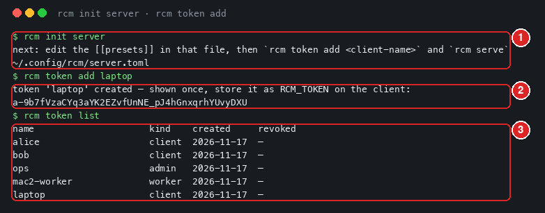

1. **`rcm init server`** 가 `~/.config/rcm/server.toml` 을 쓰고 그 경로를 찍는다. 열어서 예시
   프리셋을 팀이 실제로 돌리는 명령으로 바꾸고, 다른 컴퓨터의 세션을 받을 거면
   `bind = "0.0.0.0"` 으로 둔다.
2. **`rcm token add laptop`** 이 토큰을 **한 번만** 보여 준다. 바로 복사한다. 서버는 해시만
   갖고 있어서 다시 보여 줄 수 없다. 머신마다 하나씩 만들면 하나만 폐기할 수 있다.
3. **`rcm token list`** 는 이름 · 종류 · 날짜만 보여 준다. 비밀은 절대 안 나온다.
   `rcm token add ops --admin` 은 관리자 토큰, `rcm token revoke laptop` 은 폐기다.

이제 켠다:

```sh
rcm serve      # http://127.0.0.1:8787 · Ctrl-C 로 깨끗이 멈춘다
```

이 터미널은 그대로 둔다. 로그아웃해도 계속 돌게 하려면
[빌드 머신 운영](operating.md#run-as-a-service)의 서비스 파일을 쓴다.

**`rcm setup` 에 맡겨 서비스까지 쓰게 할 수도 있다.**
`rcm setup --role coordinator-worker --bind 127.0.0.1 --yes` 는 같은 템플릿으로 같은 `server.toml` 을
쓰고, `~/.config/rcm/service/` 아래에 launchd 나 systemd 파일도 쓴다. 그리고 그 서비스를 설치하고
띄우는 줄과 토큰을 만드는 줄을 찍는다. 그 줄은 setup 이 직접 실행하지 않는다. 서비스가 돌고 이
머신에 클라이언트 토큰이 있으면 `rcm doctor --role coordinator-worker` 가 이 머신이 무엇을 빌드하고
시험할 수 있는지, 먼저 무엇을 깔아야 하는지 알려 준다. 차례는
[처음 설정](#처음-설정-역할을-고르고-설정한다)에 있다.

## 3. 내 컴퓨터

세션이 알아야 하는 건 두 가지다. 서버가 **어디** 있는지, 그리고 **내가 누구**인지. 자동이 되는
건 앞의 하나뿐이고, 그 차이를 알고 시작하는 게 낫다.

같은 네트워크라면 첫 번째는 답하지 않아도 된다. 뭐가 있는지 물어보자:

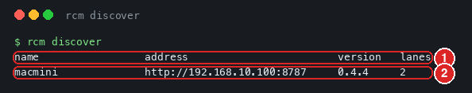

1. 머리줄이 칸 이름을 알려 준다. 서버 이름 · 주소 · 버전 · lane 수.
2. 서버 하나에 한 줄. 딱 하나만 나오면 설정에서 `server` 를 아예 빼도 된다. rcm 이 그걸 쓴다.
   아무것도 안 나오면 서버가 다른 네트워크에 있거나 `advertise` 가 꺼진 것이다. 그럴 땐 주소를
   직접 적는다.
3. 묻는 컴퓨터에서 도는 서버는 여럿이어도 다 나온다. rcm 이 루프백 인터페이스로도 묻고, 서버마다
   거기서 답하기 때문이다. 다른 컴퓨터의 서버는 네트워크로 온 질문을 들어야 한다. macOS 에서 그런
   서버가 빠지면 그 `rcm serve` 를 돌리는 프로세스에 로컬 네트워크 권한이 있는지 본다(시스템 설정 >
   개인정보 보호 및 보안 > 로컬 네트워크).

`server` 를 비우려면 **양쪽 머신 다 rcm 0.2.2 이상**이어야 한다. 그 아래 클라이언트에는 발견
기능이 아예 없다. `no server configured` 로 멈추고, `rcm worker` 와 달리 서버와 버전을 맞춰
보지도 않아서 진짜 원인을 짚어 주는 것도 없다. 애매하면 주소를 적자
(`http://<빌드머신>.local:8787`). 비용도 없고 언제나 된다.

**네트워크에 서버가 여럿일 때.** 발견이 rcm 서버를 둘 이상 찾으면 클라이언트는 하나를 고르지
않는다. 서버마다 이름과 주소를 늘어놓고 `several rcm servers on this network: … — pick one with
--server or client.toml` 로 멈춘다. 그중 하나를 적는다. 명령 하나에만 쓰려면 `--server
http://192.0.2.10:8787` 을 붙이고, 계속 쓰려면 `client.toml` 에 `server = "http://192.0.2.10:8787"`
을 적는다. 워커는 이름으로 고른다. `worker.toml` 에 `server_name = "<이름>"` 을 적는다.
`rcm setup --role client` 는 네트워크를 뒤지지 않는다. `--server` 가 꼭 있어야 하고, 나중에
발견을 쓰려면 `client.toml` 에서 `server` 줄을 지우거나 `server = "auto"` 로 바꾼다. 서버가 답하는
이름은 짧은 호스트 이름이고, 바꾸려면 그 서버의 `server.toml` 에 `advertise_name` 을 적는다.
`rcm setup` 에는 그 값을 받는 플래그가 없다.

**토큰은 발견되지 않는다. 앞으로도 그렇다.** `rcm token add` 는 빌드 머신에서 돌고 서버의 DB 에
바로 쓴다. 토큰을 내주는 API 는 없다. 누군가 손으로 옮겨야 한다. 그래서 새 머신의 첫 화면이
이런 모양인 건 정상이다:

```
ok    server    v0.2.3 (found on this network)
FAIL  token     no token
ok    presets   gate, gate-smoke, ...
ok    pools     default (1 lane)
```

초록 셋에 빨강 하나. 서버는 토큰 없이도 큐를 보여 줄 만큼 열려 있어서(`read_auth = "none"`) 다
된 것처럼 보인다. 아니다. 쓰기는 전부 토큰이 필요하고, 토큰을 옮기는 것이 남은 유일한 단계다.

`~/.config/rcm/client.toml` 을 쓴다. 토큰이 들어가니 남이 읽으면 안 된다:

```sh
mkdir -p ~/.config/rcm && cat > ~/.config/rcm/client.toml <<'EOF'
server = "http://macmini.local:8787"   # 같은 네트워크면 이 줄은 빼도 된다
token = "<2번에서 받은 토큰>"
label = "alice@laptop"                 # 큐에 요청자로 보일 이름
EOF
chmod 600 ~/.config/rcm/client.toml
```

`rcm setup --role client --server http://macmini.local:8787 --yes` 는 토큰만 빼고 같은 파일을 쓴다.
토큰 줄은 직접 넣거나 `RCM_TOKEN` 으로 준다.

진짜 작업을 맡기기 전에 경로 전체를 증명한다:

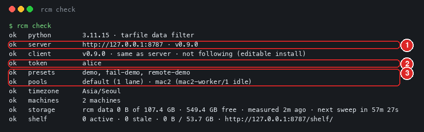

1. **server** — 어떤 주소를 썼고 서버가 어떤 버전으로 답했는지. 버전이 많이 다르면 맞추는 게
   좋다(`rcm worker` 는 아예 거부한다). 내 `rcm` 은 서버 버전을 스스로 따라간다. 서버가 다른
   버전을 돌리면 다음 명령이 서버의 wheel(`/client/remote_ci_monitor-<version>-py3-none-any.whl`)을
   받아 `rcm: following server v…` 를 한 번 찍고 그 코드로 돈다. 바로 아래 `client` 행이 그것을
   `following (installed v…)` 로 보여 준다. 따라가지 못했으면 그 이유와 서버 wheel 을 손으로 까는
   명령 한 줄을 찍는다. 설치한 rcm 을 그대로 쓰려면 `RCM_CLIENT_VERSION=installed` 를 두거나 한
   번만 `--no-follow` 를 붙인다. `--help` 는 언제나 설치한 rcm 의 도움말을 보인다. 자세한 건
   [keeping clients on the server's version](operating.md#keeping-clients-on-the-servers-version).
2. **token** — 이 토큰이 어느 이름의 것인지, 관리자인지. 여기가 `FAIL` 이면 토큰이 틀렸거나
   폐기된 것이고, 나머지는 전부 안 된다.
3. **presets · pools** — 이 서버가 무엇을 제공하는지, 그리고 지금 실제로 돌 수 있는지. 살아 있는
   워커가 없는 풀이 바로 「작업이 영영 안 시작되는」 이유다.

모든 줄이 `ok` 여야 한다. `warn` 줄은 알림이지 실패가 아니다. `rcm check` 는 그래도 0 으로 끝난다.

### Windows (WSL)

rcm 은 Windows 자체에서는 돌지 않는다. Windows 컴퓨터의 세션은 WSL 안에서 rcm 을 돌리고,
네트워크에 있는 빌드 머신의 클라이언트가 된다. Windows 에서 바로 띄우면 rcm 은 한 줄을 찍고
종료 코드 2 로 곧바로 멈춘다:

```
rcm: native Windows is not supported — install and run rcm inside WSL (see docs/usage.md «Windows (WSL)»)
```

1. **Windows 11 의 WSL2 에 Ubuntu.** WSL 안에 Python 3.11.4 이상이 있어야 한다. Ubuntu 24.04 는
   Python 3.12 를 담고 있어서 된다. Ubuntu 22.04 는 Python 3.10 이라 안 된다.
2. **pipx 는 apt 로.** Ubuntu 24.04 는 PEP 668 을 따른다. 그래서 `python3 -m pip install --user pipx`
   는 `externally-managed-environment` 로 거부된다. pipx 를 apt 로 깔고 새 셸을 연다:

   ```sh
   sudo apt install pipx && pipx ensurepath
   pipx install git+https://github.com/monocsp/remote_ci_monitor
   ```

3. **빌드 머신의 주소를 준다.** `.local` 이름보다 IP 주소를 쓴다. 그 이름은 mDNS 로 답하는데, WSL
   은 기본 설정에서 mDNS 를 보지 못한다. 토큰은 [2단계](#2-빌드-머신)처럼 빌드 머신에서
   `rcm token add` 로 만든다:

   ```sh
   rcm setup --role client --server http://192.0.2.10:8787 --yes
   export RCM_TOKEN=<받은 토큰>
   rcm check
   ```

4. **발견과 네트워크 방식.** WSL2 의 기본 네트워크는 NAT 이고, 멀티캐스트를 넘기지 않는다. 그래서
   그 안에서는 `server = "auto"` 와 `rcm discover` 가 아무것도 찾지 못하고, rcm 이 그렇다고 알린다:

   ```
   rcm: no rcm server found on this network (is the server's advertise on? same Wi-Fi?) — give its address with --server http://<address>:8787 — under WSL2 the default NAT network does not pass multicast, so use --server or WSL's mirrored networking
   ```

   mirrored 네트워크를 켜면 WSL 이 Windows 의 네트워크 인터페이스를 같이 쓴다. Windows 11 22H2
   이상에서 `%UserProfile%\.wslconfig` 의 `[wsl2]` 아래에 `networkingMode=mirrored` 를 적고
   `wsl --shutdown` 으로 다시 띄운다. 그러면 발견이 될 수도 있지만 rcm 으로는 확인하지 않았다.
   `--server` 는 언제나 된다. 자세한 건 Microsoft 의
   [WSL networking](https://learn.microsoft.com/en-us/windows/wsl/networking) 문서를 본다.
5. **Tailscale.** Tailscale 은 WSL 안이 아니라 Windows 에 깐다. WSL 은 Windows 를 거쳐 tailnet 에
   닿는다. `--server` 에는 빌드 머신의 Tailscale 주소를 준다.
6. **저장소는 WSL 의 파일 시스템에 둔다.** `/mnt/c` 아래가 아니라 WSL 안의 `~/` 아래에 받는다.
   `/mnt/c` 에서는 스크립트의 실행 비트가 제대로 남지 않고 파일 읽기도 느리다. Git for Windows 가
   `core.autocrlf` 를 켠 채 받은 저장소는 줄 끝이 CRLF 이고, CRLF 셸 스크립트는 빌드 머신에서
   돌지 않는다. WSL 안의 git 으로 받거나, 저장소의 `.gitattributes` 에 `*.sh text eol=lf` 를 적는다.
7. **`--notify` 는 아무것도 띄우지 않는다.** WSL 에는 rcm 이 쓰는 데스크톱 알림 도구가 없어서
   `rcm wait --notify` 는 대신 경고 한 줄을 찍는다. JSON 과 종료 코드는 바뀌지 않는다.

## 4. 첫 작업

`rcm run` 은 지금 서 있는 디렉터리를 보내고, 기다리고, 답을 준다.

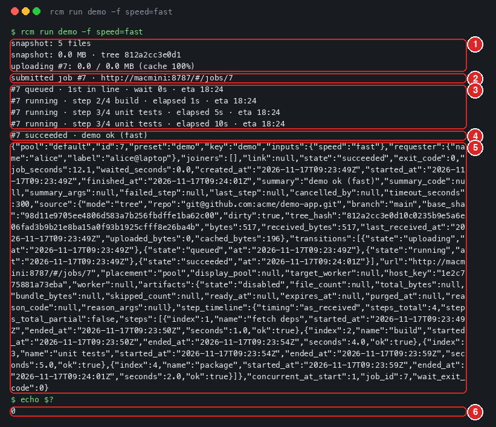

1. **스냅샷.** git 이 추적하는 것 + 무시되지 않은 미추적 파일 − `.rcmignore` 패턴. 파일 수와
   크기, 그리고 실제로 올린 양을 말해 준다. 서버는 한 번 본 파일을 갖고 있어서, 거의 안 바뀐
   트리의 두 번째 실행은 거의 아무것도 안 보낸다.
2. **작업 번호와 URL.** 그 링크를 열면 웹 화면에서 이 작업을 보고 있게 된다.
3. **진행**, 단계마다 한 줄, 경과 시간과 예상 종료 시각과 함께. 단계 이름은 스크립트가
   `::rcm::step::…` 로 찍은 그대로다.
4. **판정**, 스크립트가 찍은 한 줄 요약과 함께.
5. **stdout 에 JSON 한 줄** — 작업에 대한 전부다. 상태 · 시간 · 단계 · 실패한 단계. 위의 것들은
   전부 stderr 였으니 `rcm run … | jq` 는 이 줄만 받는다.
6. **종료 코드.** 스크립트가 분기해야 하는 값이다. 0 이면 통과다.

### 게이트 한 바퀴

**게이트**는 머지 전에 빌드 머신이 돌리는 프리셋이다 — 분석 · 테스트 · 린트를 스크립트 하나로,
보통 전체와 빠른 통과를 고르는 `scope` 입력과 함께. 여기에는 그림이 없다. 아래가 내 머신의
프로젝트 디렉터리에서 도는 전체 흐름이고, 터미널 · CI 래퍼 · 에이전트 세션 어디서든 명령은 같다.

1. **한 번 확인.** `rcm check` — `python` · `server` · `token` · `presets` · `timezone` · `client` ·
   `cancel` 이 전부 `ok` 여야 한다. `presets` 에 `gate` 가 없으면 서버 쪽에서 아직 정의하지 않은
   것이다([Configuration](configuration.md)). `rcm presets` 가 프리셋과 입력을 전부 보여
   준다.
2. **줄 서기 전에 본다.** `rcm eta gate -f scope=full` 은 아무것도 제출하지 않고 내 순번 · 앞 작업
   수 · 대기 시간 · 예상 소요 · 끝나는 시각 · 그 추정의 `confidence` 를 찍는다.
3. **저장소 루트에서 제출.** `rcm run gate -f scope=full --by "$(whoami)@$(hostname -s)"` 은
   현재 디렉터리를 스냅샷하고(추적 파일 + 무시되지 않은 미추적 파일, `.rcmignore` 제외), 같은
   작업이 이미 대기·실행 중이면 합류하고, 서버에 없는 파일만 올리고, 기다린다. 진행은 stderr 로
   `::rcm::step::` 마다 한 줄, 결과는 stdout 에 JSON 한 줄. 입력은 `-f 이름=값`, `--by` 는
   큐에 보이는 이름(기본 `user@host`). git 이력이 필요한 게이트는 푸시된 ref 로 돈다 —
   `rcm run gate --source git_ref --ref my-branch` 는 아무것도 올리지 않으니 먼저 푸시한다.
4. **종료 코드로 분기.** 0 성공 · 1 실패 · 2 취소나 시간 초과 · 3 모름 — 3 은 실패가 아니다
   ([Exit codes](../README.ko.md#exit-codes)). JSON 에는 `job_id` · `url` · `state` · `exit_code` ·
   `summary` · `failed_step`(스크립트가 선언했을 때만) · `last_step` · `failures`(스크립트가 보고한
   이름마다 이 프리셋의 최근 실행에서 몇 번 빨갰는지) · `step_timeline` 이 실린다.
   `examples/session/ci-gate.sh` 가 완성된 래퍼다(`jq` 필요).
5. **빨갈 때.** `rcm logs N` 이 로그를 보여 준다(도는 중이면 `--follow`). 판정 줄은 스크립트가
   선언한 실패 단계를, 선언이 없으면 `last step …` 을 말한다. `rcm artifacts N --fetch` 는
   프리셋이 낸 보고서를 가져온다. 종료 3 은 rcm 이 모른다는 뜻이다 — 서버가 재시작됐거나 경로가
   끊긴 것 — 다시 돌리기 전에 `rcm jobs` 를 본다.
6. **떼어 놓고 나중에.** `--no-wait` 는 작업 번호 · 순번 · ETA 를 찍고 돌아온다. `rcm wait --job N`
   으로 다시 붙는다. `rcm run` 중 Ctrl-C 도 떼어 놓기다 — 작업은 계속 돈다.
7. **취소.** `rcm cancel N` 은 내 작업을 멈춘다(`rcm run` 이 제출의 취소 토큰을
   `~/.local/state/rcm/submissions.json` 에 저장해 둔다). 남의 작업에 합류만 했다면 목록에서
   나만 빠지고 작업은 계속 돈다. 관리자 토큰은 무엇이든 취소한다.
8. **두 세션, 한 커밋.** 같은 프리셋 · 입력 · 트리로 두 번째 `rcm run` 을 하면 첫 작업에 합류해
   같은 결과를 받는다. `--no-join` 은 따로 돌린다.
9. **빠른 통과.** 프리셋에 가벼운 scope(`-f scope=fast` · `commit`)가 있으면 반복할 땐 그걸
   쓰고 머지에는 `full` 을 쓴다. 지금 각각 얼마나 걸리는지는 `rcm eta` 가 말해 준다.
10. **클라이언트를 맞춘다.** 0.8.0 부터 설치한 `rcm` 은 서버 버전을 따라간다.
    [3. 내 컴퓨터](#3-내-컴퓨터)와
    [keeping clients on the server's version](operating.md#keeping-clients-on-the-servers-version)을
    본다.

## 5. 기다리지 않기

`--no-wait` 는 제출만 하고 바로 돌아온다. 나중에 아무 때나 다시 붙으면 된다.

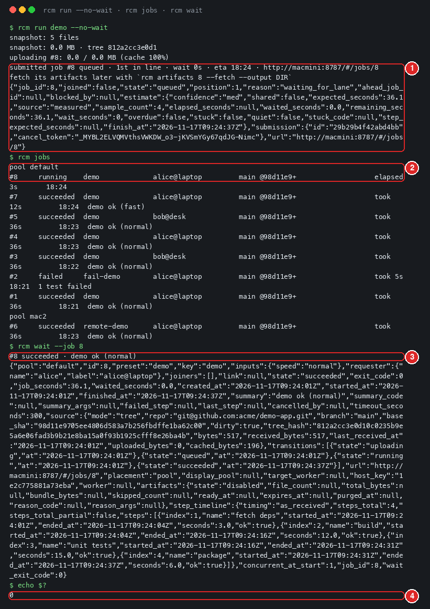

1. **내고 가기.** 줄 하나가 작업 번호와 상태, 몇 번째인지, 언제 끝날지를 말한다. JSON 은 같은
   것을 `position` · `reason` · `estimate` 로 싣는다. 이미 도는 작업은 순번이 없어서 그 조각이
   빠진다 — 지어내지 않는다. 아예 시작할 수 없는 큐(정지했거나 워커가 없는 풀)에는 끝날 시각도
   없다 — 시작할 수 없는 작업에 시각을 주지 않는다. 큐를 못 읽으면 순번만 빠지고
   종료 코드는 그대로 0 이다. `--no-wait` 의 0 은 「제출됐다」는 뜻이지 「조회됐다」가 아니다.
2. **메모리가 빠듯한 기계라면** 이 패턴을 기본으로 삼는다. `rcm run --no-wait` 이 작업 번호를
   찍고 돌아오고, `rcm wait --job N` 으로 아무 때나 다시 붙는다. 기다리는 클라이언트는
   작고(수십 MB — 기다리는 동안에는 트리 크기를 따라 늘지 않는다) 놀고 있지만 빌드 내내 떠
   있는 프로세스이고, 운영체제가 그걸 죽이면 셸은 137 을
   본다 — 그건 **작업의 실패가 아니다**. 작업은 빌드 머신에서 계속 돌고 있으니 다시 붙으면
   진짜 답이 나온다.
3. **`rcm jobs`** 는 대기 · 실행 · 최근 끝난 작업을 풀별로 보여 준다. 누가 냈고 얼마나 걸렸는지도.
4. **`rcm wait --job N`** 은 이미 있는 작업에 붙어 이벤트 스트림으로 따라가고 작업이 끝나면 끝난다.
   Ctrl-C 로 다시 떼어 놔도 작업은 계속 돈다.
5. 종료 코드는 처음부터 기다린 것과 똑같이 그 작업의 것이다.
6. 끝 줄은 작업이 어느 머신에서 얼마나 돌았는지 알려 준다.
   `#381 succeeded on build-02 · 6m 31s · artifacts ready` 처럼 찍힌다. 그 뒤에 경고 줄, 로그 줄,
   보관 줄이 올 수 있다. 실패한 작업이면 실패한 스텝을 덧붙인다(`· step test`). 프리셋이 산출물을
   선언하지 않았으면 산출물 상태는 빠진다. 시작하지 못한 작업은 산출물을 말하지 않는다.
   산출물이 `failed` · `dropped` · `unavailable` · `unknown` 이면 경고 줄이 하나 더 나온다.
   아직 `collecting` 이나 `uploading` 이면
   `#381 artifacts still collecting (uploading) — see them later with rcm artifacts 381` 이
   나온다. 두 줄 모두 종료 코드를 바꾸지 않는다. JSON 에는 같은 머신이 `ran_on` 으로 실린다.
   빌드 머신 자신의 레인에서 돈 작업의 `worker` 는 지금처럼 `null` 이다. 그 레인의 `ran_on` 은
   작업이 돌던 때가 아니라 지금 서버의 호스트 이름을 따른다.
7. **`rcm wait --job N --notify`** 는 기다림이 끝날 때 기다리던 컴퓨터에 데스크톱 알림도 띄운다.
   알림은 JSON 줄을 낸 뒤에 뜬다. macOS 는 `osascript`, Linux 는 `notify-send` 를 쓴다. 도구가
   없거나 알림을 띄우는 중에 Ctrl-C 를 누르면 경고 한 줄을 찍고 원래대로 끝난다. 이 플래그를
   줄 때만 켜지고 `rcm run` 에는 없다. 알림을 받으려면 `--no-wait` 로 낸 뒤 `--notify` 로
   기다린다.

**지금 대신 나중에.** `rcm run deploy --ref main --at 15:00` 은 서버에 시각을 넘긴다. 길이로
주려면 `--in 90m` 을 쓴다. 작업은 `scheduled` 상태로 기다리다가 그 시각에 큐에 들어간다.
`rcm jobs` 는 그 작업을 `at 15:00` 으로 보여 주고, `rcm wait --job N` 은
`scheduled for 15:00 · start by 15:15` 를 찍고 계속 기다린다. 그 시각부터 시작 마감까지 어느
레인도 그 작업을 집지 않으면 작업은 `expired` 로 끝나고 종료 코드는 2 다. 작업이 돌지 않았다는
뜻이다. 시작 마감은 프리셋이 따로 정하지 않으면 15분이다. 자세한 규칙은
[나중에 돌리기](configuration.md#running-a-job-later---at-and---in)에 있다.

**나중에 다시.** 프리셋에 `[presets.retry]` 표가 있으면 스크립트가 75(「아직」)로 끝날 때 rcm 이
`interval_seconds` 마다 다시 돌린다. 횟수는 `max_attempts` 까지다. 시도마다 새 작업이 생긴다.
`rcm wait --job N` 은 `#57 exit 75 · attempt 1 of 12 · retrying as #58 — waiting for it` 을
찍고 사슬의 끝까지 따라간다. 마지막 시도도 75 로 끝나면 `exhausted` 이고 종료 코드는 1 이다.
사슬에 속한 아무 작업 번호로 `rcm cancel` 을 보내도 사슬이 멈춘다. 자세한 규칙은
[나중에 다시 돌리기](configuration.md#trying-again-later-presetsretry)에 있다.

`rcm logs N` 은 로그를 찍고, `rcm logs N --follow` 는 끝날 때까지 계속 찍고, `rcm cancel N` 은
멈춘다.

**사람이 손대야 할 때.** 로그인이 풀린 것처럼 스크립트 혼자 더 나아갈 수 없으면 스크립트가
`::rcm::action::<code>::<note>` 를 찍는다. 그러면 `rcm wait` 는 stderr 에
`#412 needs action · login · Sign in on the build machine` 을 찍고 작업 행의 이유는
`needs action` 이 된다. `rcm wait --job N --return-on-action` 은 그 순간 `action` 이 든 JSON 을
찍고 종료 코드 4 로 돌아온다. 작업은 계속 돈다. 그래서 결과를 기다리던 세션이 차례를 돌려받아
사람에게 물을 수 있다. 사람이 손을 쓴 뒤에는 플래그 **없이** 다시 기다린다. 표식은 작업에 그대로
남아 있어서 플래그를 주면 곧바로 또 돌아오기 때문이다([자세히](configuration.md#when-a-person-has-to-act)).

`rcm cancel N` 은 제출할 때 함께 받은 cancel token 을 보낸다 — `rcm run` 이
`~/.local/state/rcm/submissions.json`(`$XDG_STATE_HOME` 이 있으면 그 아래 `rcm/submissions.json`,
권한 0600)에 남겨 둔 것이다. 그래서 제출한 세션은 취소할 수 있고, 다른 상태 디렉터리의
세션 — 다른 사용자나 다른 머신 — 은 같은 클라이언트 토큰이어도 못 한다. 같은 사용자의 두
세션은 그 파일을 나눠 쓴다: 그때 `rcm cancel N` 은 이 클라이언트 토큰으로 낸 그 작업의 **가장
최근** 제출의 token 을 보내고(다른 토큰이 남긴 항목은 절대 집지 않는다), 합류한 세션은 합류만
빠지고 작업을 취소하지 않는다; 특정 제출을 고르려면
`--submission-id`(`--no-wait` JSON 의 `submission.id`)를 준다. 다른 머신에서, 또는 `--no-wait`
JSON(`submission.cancel_token` 이 들어 있다)을 간직한 래퍼에서는 `--cancel-token` 으로
넘긴다(`rcm cancel N --cancel-token …`). 둘 다 없으면 그렇다고 말하고 그래도 보낸다: 기본 설정의
서버는 전처럼 받고, `cancel_requires_submission_token = true` 인
서버([설정](configuration.md#who-may-cancel-a-job))는 관리자 토큰이 아니면 403 으로 거절한다.
쓴 token 은 파일에서 지워진다; 파일은 최근 200 개를 두고, 그 위로는 서버가 끝났다고 하는 작업만
버린다. 파일을 못 쓰면 `rcm run` 이 한 줄로 말하고 작업은 그대로 돈다 — 그 작업은 `--cancel-token`
으로 취소한다. cancel token 은 다른 어디에도 찍히지 않고, 상태 파일의 경로도 찍히지 않는다.

## 6. 실패했을 때

작업의 실패는 도구의 오류가 아니다. 그래서 출력이 조용하고 구체적이다.

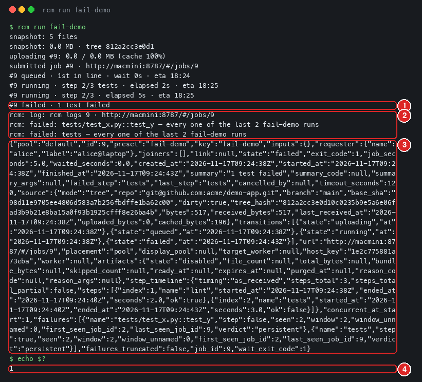

1. **판정 줄**이 실패한 단계 이름과 스크립트가 찍은 요약을 말한다. 단, 스크립트가
   `::rcm::step-end::fail` 이나 `::rcm::fail::<이름>` 으로 **밝혔을 때만**이다. 선언이 없으면
   rcm 은 짐작하지 않고 `last step <이름>` 만 보여 준다 — 끝났을 때 어디였는지를 말할 뿐 원인을
   주장하지 않는다. 여러 개를 병렬로 돌리고 로그를 나중에 되재생하는 스크립트에서는, 이 규칙이
   없으면 마지막으로 되재생된 머리말이 앞에서 난 실패를 뒤집어쓴다.
   스크립트가 자기 요약을 찍지 않았으면 요약은 종료 코드만 말하지 않고 스크립트가 밝힌 첫 이름을
   말한다: `test: x_test.dart +1 more (exit 1)`, 단계만 밝혔으면 `analyze failed (exit 1)`.
   같은 줄이 큐 · `rcm wait` · 알림 훅으로 간다
   ([무엇이 실패했는지 말하기](configuration.md#saying-what-failed)).
2. **다음에 볼 곳.** 0 이 아닌 종료는 항상 `log: rcm logs <N>` 과 작업 URL 을 찍는다. 3(모름)도
   마찬가지다 — 모를수록 로그가 필요하다. 그 아래에는 스크립트가 `::rcm::fail::<이름>` 으로
   찍은 이름마다 한 줄씩, 같은 프리셋의 최근 실행에서 몇 번 빨갰는지가 붙는다. 왔다 갔다 하면
   `2 of the last 8 gate runs · intermittent?`, 처음 보면 `first time in the last 8 gate runs`,
   계속 깨져 있으면 `every one of the last 8 gate runs`. 물음표는 일부러 붙인 것이다 — 판정이
   아니라 제안이고, 숫자가 바로 옆에 있다.
3. **JSON** 에는 `failed_step` · `last_step` · `failures` · `exit_code` · 단계별 시간이 들어
   있다. 래퍼 스크립트가 로그를 긁지 않고도 어느 단계가 깨졌는지 보고할 수 있다. 단계별
   시간은 `step_timeline` 이다 — 스크립트가 찍은 `::rcm::step::` 마다 한 항목씩
   `started_at` · `ended_at` · `seconds` · `ok` 가 있고, 작업이 도는 동안 큐가 보여 주던 바로
   그 숫자가 끝난 뒤에도 남는다. `steps: []` 는 스크립트가 단계 마커를 안 찍은 것이고,
   `step_timeline: null` 과 `step_timeline_error_code` 는 서버가 마커를 못 읽은 것이다.
   `concurrent_at_start` 는 이 작업이 시작할 때 돌던 작업 수 — 자기 포함이라 혼자 돌았으면 `1`,
   `null` 은 서버가 모르는 것 — 이고, 레인 둘을 시험할 때 볼 숫자다. 같은 문서가
   `GET /jobs/<N>` 이라 `rcm wait --job N` 도 그대로 찍는다.
4. **1 은 작업이 실패했다는 뜻이다.** 2 는 취소나 시간 초과. 3 은 *모름* — 서버가 재시작했거나
   못 닿았거나 — 이고 절대 실패로 보고되지 않는다. CI 가 3 을 빨강으로 치면 엉뚱한 이유로
   빨개진다. 5 는 **전달** 실패고 `--fetch-artifacts` 에서만 나온다 — 작업 자체의 결과는
   `wait_exit_code` 에 그대로 있고, 못 온 것은 파일이다([파일을 돌려받기](#8-파일을-돌려받기)).
   4 는 `rcm wait --return-on-action` 에서만 나온다. 작업이 사람에게 할 일을 알렸고 아직 돌고
   있다는 뜻이다([기다리지 않기](#5-기다리지-않기)).

5. **시작조차 못 한 작업은 그렇다고 말한다.** 스크립트가 돌기 전에 끝나는 실패들이 있고, 요약이
   그중 어느 것인지 말한다. 워크스페이스를 못 만들었다(`snapshot_missing` ·
   `snapshot_rejected` · `blob_missing` · `repo_missing` · `commit_missing` · `git_failed` ·
   `snapshot_download_failed`), 프로세스를 못 띄웠다(`launch_executable_missing` ·
   `launch_permission_denied` · `launch_failed` · `log_unavailable`), 큐에 있는 사이 프리셋이
   설정에서 사라졌다(`preset_missing`), `requires` 의 도구가 없다(`tool_missing`). 전부
   `summary_code` 를 달고 `exit_code` 는 `null` 이다 — 그래서 스크립트가 문장을 읽지 않고도
   「내 테스트가 깨졌다」와 「작업이 아예 안 돌았다」를 구분한다. 이 요약에는 자유 문구가 **하나도**
   실리지 않는다: 인자는 코드이거나, 작업에 이미 있는 이름이거나, 숫자다. 원문은 — 못 띄운 명령까지
   — 토큰이 있어야 보는 작업 로그에만 남는다. 거기에도 아무것도 없는 경우는 하나뿐이다:
   `log_unavailable` 은 그 로그 파일을 못 연 것이라 적을 곳이 없다.

취소한 작업에는 실패 단계도 마지막 단계도 없다. 사람이 세운 것이지 깨진 것이 아니다.

## 7. 같은 트리를 두 세션이 낼 때

같은 커밋을 두 사람이 검사하는데 줄을 두 번 설 이유는 없다.

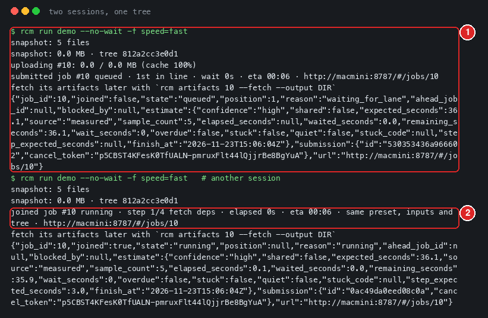

1. 첫 제출이 작업을 만든다.
2. 프리셋 · 입력 · 트리가 같은 두 번째 제출은 그 작업에 **합류**한다. 두 번 돌지 않고, 두 번
   기다리지 않고, 결과는 둘 다 받는다. `--no-join` 으로 끌 수 있고, 합류한 작업을 취소하면 합류만
   빠진다.

### 다시 push 했을 때

프리셋이 `supersede` 를 켜 두었으면([설정](configuration.md#superseding-older-jobs-of-the-same-branch)),
같은 브랜치 · 프리셋 · 입력의 새 작업이 큐에 들어오는 순간 내 옛 작업을 치운다 — 찾아서 직접
취소할 필요가 없다. 옛 작업은 `cancelled` 로 끝나고 요약은 `superseded by #57` 이다. 그 작업을
기다리던 세션은 종료 코드 2 와 함께 다음에 볼 곳을 말하는 한 줄을 받는다.

```
$ rcm wait --job 41
#41 superseded by #57 — rcm wait --job 57
```

치우는 것은 내 작업뿐이고, 다른 사람이 합류해 있으면 치우지 않는다. `rcm run --no-supersede` 는
이번 제출만 옛 작업을 그대로 둔다(흔들리는 테스트를 두 판 나란히 볼 때).

## 8. 파일을 돌려받기

파일을 다시 만드는 작업은 그 결과를 빌드 머신에 남긴다. `--fetch-artifacts` 는 그것을 **제출한 그
트리의 같은 경로**로 가져온다.

```sh
rcm run goldens --fetch-artifacts
```

```
artifacts: 64 files · 12.4 MB
artifacts: new 0 · changed 12 · unchanged 51 · conflicted 1
artifacts: wrote 12, unchanged 51, conflicted 1
```

1. 프리셋이 무엇을 모을지 먼저 선언해야 한다(`artifacts = ["test/**/goldens/*.png"]` —
   [설정](configuration.md#getting-files-back-out-of-a-job)). 선언이 없으면 아무것도 안 모으고
   아무것도 안 온다. 그건 실패가 아니다.
2. **기다리는 동안 내가 고친 파일은 절대 덮어쓰지 않는다.** `conflicted` 로 세고 그대로 둔다.
   `--force` 는 그것까지 덮고, `--dry-run` 은 표만 찍고 아무것도 안 쓴다.
3. 마지막 줄은 「비교한 것」과 「실제로 쓴 것」을 가른다. 골든 갱신에서는 `wrote` 가 곧 답이다.
4. 전부 쓰고 나면 세션이 서버에 알린다. 아무도 합류하지 않은 작업이면 그 자리에서 지워지고,
   합류한 사람이 있으면 그 사람도 받을 수 있게 24시간 남는다.
5. `git_ref` 프리셋은 제출한 트리가 없다. 그래서 `--output DIR` 로 쓸 곳을 말해야 하고, 기준이
   비어 있어 이미 다른 내용으로 있던 파일은 `conflicted` 라 `--force` 라야 덮는다.
6. **종료 코드가 「받았나」를 말한다.** 0 은 받았다는 뜻이거나, 애초에 받을 것이 없었다는
   뜻이다 — 프리셋이 `artifacts` 글롭을 선언하지 않았거나(`disabled`) 글롭에 맞는 파일이
   없었거나(`empty`). 그 밖은 전부 **5** 다: 작업이 아직 안 끝났거나(`pending`), 묶음이
   버려졌거나 깨졌거나 만료됐거나 이미 지워졌거나, 디스크의 파일을 덮어야 하는데 `--force`
   가 없었거나. 작업 자체가 실패했으면 그 작업의 종료 코드가 먼저다 — 깨진 테스트가 없는 파일보다
   중요하다.
7. `--dry-run` 은 「이거 깨끗하게 적용되나?」에 **그때 냈을 코드**로 답한다. 깨끗하면 0,
   `conflicted` 가 하나라도 있으면 5. 어느 쪽이든 아무것도 쓰지 않는다.

`--no-wait` 로 냈거나 다른 곳에 받고 싶다면:

```sh
rcm artifacts 412                          # 무엇이 있나
rcm artifacts 412 --fetch --output ./out   # 지정한 디렉터리에 쓴다
```

### 오래 두기: 보관함

묶음은 길어야 하루 산다. 다음 주에 그 파일을 다시 보거나 폰에서 열고 싶으면 그 작업을 서버의
보관함에 넣는다.

```sh
rcm run golden-update --keep
```

```
#412 succeeded · 12 goldens updated
shelf: http://macmini.local:8787/shelf/412/
```

1. 같은 네트워크(또는 Tailscale)의 아무 브라우저에서 링크를 연다. 작업 정보, 그림, 파일 표가
   보이고 *zip 으로 받기* 로 전부 받는다. 토큰은 필요 없다.
2. 프리셋에 `keep = true` 가 있으면 늘 보관한다. `--keep` 은 `artifacts` 를 선언한 프리셋이면
   그 작업 하나만 보관한다.
3. `rcm keep 412` 는 이미 끝난 작업을 보관한다. 묶음이 아직 남아 있을 때만 된다.
   `--fetch-artifacts` 로 받은 작업은 받는 순간 묶음이 지워지므로 처음부터 --keep 을 붙인다(두
   플래그를 같이 써도 된다).
4. `/shelf/latest/golden-update?branch=dev` 는 늘 `dev` 의 가장 최근 golden-update 보관 항목을
   연다. 북마크해 두면 된다.
5. 손으로 치울 것은 없다. 여섯 달 동안 아무도 열지 않은 항목은 *정리 대기* 로 옮겨 가고, 1년
   동안 쓰지 않으면 지워진다. 열거나 받거나 *되살리기* 를 누르면 시계가 다시 돈다. `rcm shelf` 는
   목록을 보이고, `rcm shelf rm 412`(관리자)는 그 자리에서 지운다.

서버에 닿는 사람은 누구나 보관함을 열 수 있다. 그러니 `artifacts` 에 비밀을 넣지 않는다
([누가 여나](configuration.md#keeping-a-jobs-files-the-shelf)).

스크립트에서는 `--keep --no-wait` 로 내고 출력에서 링크를 읽는다. 나중에 어느 컴퓨터에서든 토큰 없이
그 파일을 다시 받는다.

```sh
rcm run app-map-shots --keep --no-wait
# submitted job #412 queued · …
# fetch its artifacts later with `rcm artifacts 412 --fetch --output DIR`
# shelf: http://macmini.local:8787/shelf/412/ (after the job finishes)
rcm wait --job 412
rcm shelf get http://macmini.local:8787/shelf/412/ --output .
rcm shelf get --latest app-map-shots --branch dev --output .
curl "http://macmini.local:8787/api/shelf/latest/app-map-shots?branch=dev"   # 같은 내용을 JSON 으로
```

경로는 보관할 때 그대로 붙는다. 그래서 프로젝트 폴더에서 `--output .` 을 주면 작업이 만든 자리에
그대로 풀린다. `rcm shelf get` 은 파일마다 sha256 을 대조하고, 하나라도 다르면 아무것도 쓰지 않는다. 프리셋에
`keep = true` 를 넣는 일은 서버가 v0.7.0 으로 오른 뒤에만 한다. 옛 서버는 그 키를 거절한다
([스크립트에서 쓰기](configuration.md#using-the-shelf-from-a-script)).

## 9. 한 화면으로 보는 큐

`rcm top` 은 터미널 하나에 띄워 두는 명령이다.

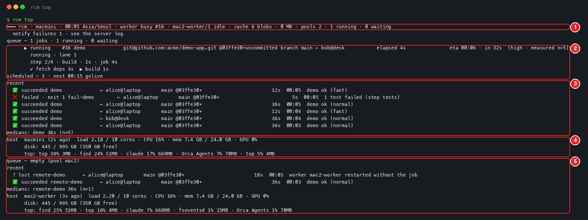

1. **머리줄**: 어느 서버인지, 거긴 몇 시인지, 워커가 뭘 하는지, 스냅샷 캐시가 얼마나 쌓였는지.
2. **큐**: 지금 도는 작업과 그 단계, 기다리는 작업과 순번과 ETA. 작업이 안 움직이는 이유는 추측이
   아니라 명시된다.
3. **최근 결과와 중앙값** — 이 프리셋이 보통 얼마나 걸리는지, 실제 실행에서 나온 값. ETA 가
   여기서 나온다.
4. **호스트**: load · CPU · 메모리 · 디스크 · GPU · 무거운 프로세스. 「응답 없음」과 「머신이
   바쁜 것」을 구분하는 자리다.
5. **다른 풀**은 자기 구역을 갖는다. 두 번째 빌드 머신도 같은 화면에서 보인다.

예약이 있는 풀에는 `scheduled — 2 · next 15:00 golive` 한 줄이 더 붙는다.

`rcm top --watch 5` 는 5초마다 새로 그리고, `rcm top --json` 은 기계용이다.

## 10. 웹 화면

`http://<빌드머신>:8787/` 을 연다. 설치할 게 없고 폰에서도 된다.

### 머리줄

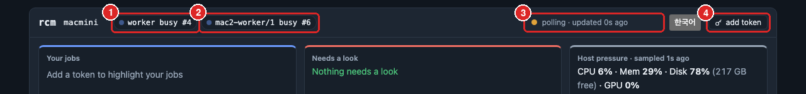

1. **로컬 워커** lane 과 지금 돌리는 작업.
2. **원격 워커**마다 풀과 작업. 응답이 끊긴 워커는 `down` 으로 보인다.
3. **연결 상태.** `live` 면 이벤트 스트림이 열려 있는 것이고, `polling` 이면 폴백이며 마지막
   성공 갱신이 얼마나 됐는지 함께 보여 준다.
4. **열쇠 버튼**에 토큰을 넣는다. 이 브라우저에만 남고 URL 에는 절대 들어가지 않는다.

### 큐

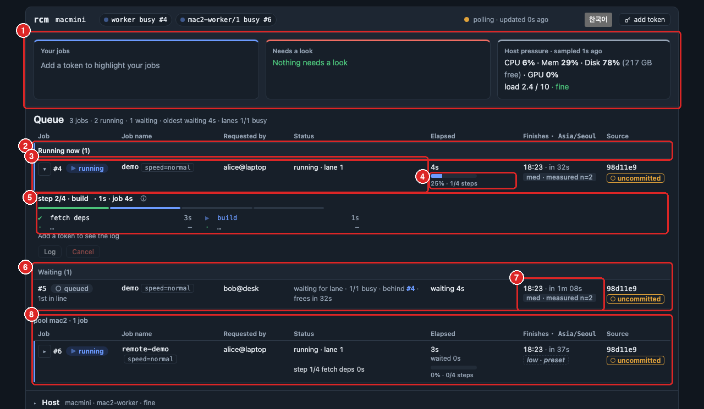

1. **한눈에 세 가지 답**: 내 작업, 확인이 필요한 작업, 머신이 얼마나 힘든지.
2. **지금 도는 것과 기다리는 것**을 개수와 함께 나눠 놓는다. 빈 묶음도 「없다」고 말하고 사라지지
   않는다 — 「도는 게 없다」와 「화면이 안 떴다」가 같아 보이면 안 되기 때문이다.
3. **실행 중인 작업.** 누가 냈고 어떤 트리를 검사하는지. 행은 접힌 채로 뜨고, 지금 도는 단계는
   상태 칸에 남는다(`단계 2/4 build 2s`) — 접어 둔 행도 무슨 일이 벌어지는지 말한다.
4. **어디까지 왔나**를 **진행 시간** 칸 안의 짧은 막대 하나로. 그리고 **무엇으로 쟀는지**를 늘
   함께 적는다: 작업이 단계 수를 알리면 `50% · 단계 4/8`, 아니면 `70% · 지난 실행 기준` ·
   `70% · 설정한 예상 시간 기준` — 그 숫자가 얼마나 믿을 만한지 같이 보인다. 선언한 단계를 다
   끝냈는데 아직 안 끝난 작업은 `단계 4/4`, 아무 말도 할 수 없는 작업(표본 없음 · 준비 중 ·
   예상 시간 초과 · 응답 없음)은 `진행률을 알 수 없음`. 글자는 거기까지다 — 예상 시간을 넘겼는지,
   응답이 없는지, 그저 조용한지는 막대의 색과 빗금이 말하고 상태 칸이 이미 글자로 말한다. 막대에
   마우스를 올리거나 화면 낭독기로 읽으면 형편까지 그대로 나온다(`50% · 단계 4/8 · 응답 없음`).
   도는 작업의 막대는 절대 가득 차지 않는다 — 가득 찬 막대는 「끝났다」는 뜻이다.
5. **그 단계들.** **▸** 로 편다. 끝난 건 체크, 지금 것은 시간과 함께. 초는 보고 있는 동안 계속
   오른다. 멈춰 있다가 새로고침 때 한 번에 뛰지 않는다. 로그 꼬리와 **로그** 버튼도 같은 블록에
   있다. **취소**는 여기 숨지 않는다 — 접힌 행에 그대로 있어서 폭주하는 작업을 한 번에 세운다.
6. **기다리는 작업**과 큐에서의 순번.
7. **ETA 와 confidence.** `high` 는 실제 5회 이상의 중앙값이고 `n=12` 가 그 횟수다(배지에
   마우스를 올리면 문장으로 나온다). `low` 는 프리셋 기반 추측, `—` 는 모른다는 뜻이다. 아는 척하지
   않는다.
8. **다른 풀.** 자기 워커와 자기 큐를 갖는다. **코드 출처** 칸에는 커밋만 남는다 — 저장소 주소는
   행마다 같은 값이 되풀이되므로 펼친 블록에 있다.

칸보다 긴 이름은 가운데를 줄인다(`android-integration-test-s… name-that-goes`) — 앞이 같은 이름들도
끝에서 갈린다. 잘린 이름을 누르면(키보드로는 Tab 으로 가서 Enter) 전문과 **복사** 단추가 뜬다. 다시
누르거나 바깥을 누르거나 Escape 면 닫힌다. hover 가 없는 폰에서도 된다.

### 예약한 작업과 사람이 할 일

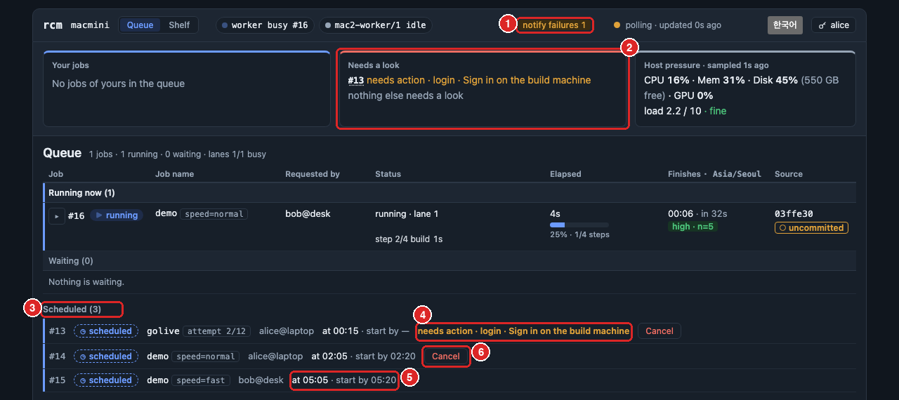

1. 머리의 **`notify failures N`**(한국어 화면에서는 `알림 실패 N`)은 서버가 켜진 뒤 알림 훅이
   실패한 횟수다. 이 수는 서버 메모리에 있어서 재시작하면 0 이 된다. 실패 하나하나는 서버 로그에
   남는다.
2. **확인 필요** 카드는 사람이 손대야 한다고 스스로 알린 작업을 짚는다.
   `needs action · login · Sign in on the build machine` 처럼 읽힌다. rcm 이 추론한 다른 이유보다
   앞에 선다([자세히](configuration.md#when-a-person-has-to-act)).
3. **예약 (N)**: `rcm run --at` 이나 `--in` 으로 낸 작업이 큐 아래에 시각순으로 선다. 서버가 예약을
   읽지 못했으면 이 절은 빈 목록이 아니라 빨간 띠로 그려진다.
4. 차례를 기다리는 **반복 시도**다. `attempt 2/12` 와 함께, 앞 시도가 찍은 사람이 할 일을 그대로
   달고 있다. 그래서 시도와 시도 사이에도 사슬은 사람을 계속 찾는다
   ([나중에 다시 돌리기](configuration.md#trying-again-later-presetsretry)).
5. **시작 시각과 시작 마감.** 예약한 작업은 큐에 들어가기 전까지 ETA 가 없다. 마감까지 어느 lane
   도 집지 않으면 `expired` 로 끝난다. 반복 시도에는 마감이 없다(`start by —`)
   ([자세히](configuration.md#running-a-job-later---at-and---in)).
6. 내 예약에는 **취소** 버튼이 있다.

### 내 작업

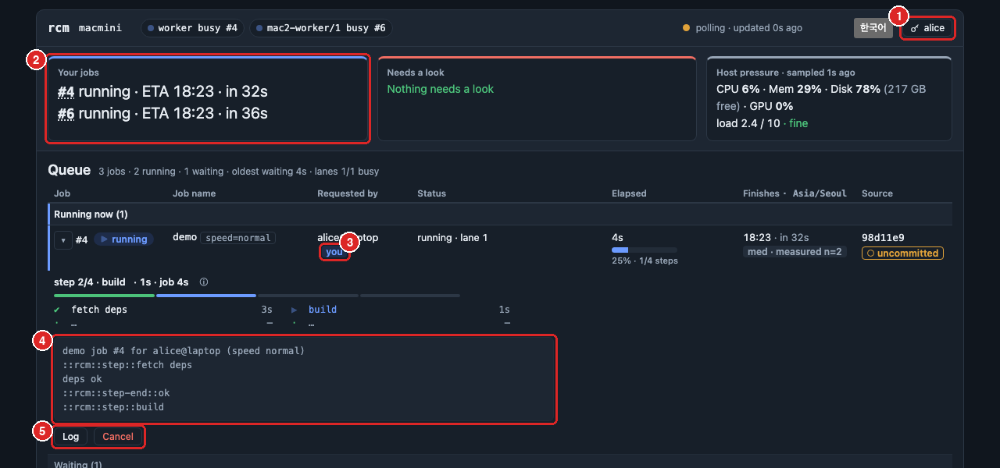

1. **열쇠 버튼** 뒤에 토큰을 붙여 넣는다. 그러면 버튼이 토큰 이름을 보여 준다.
2. 요약의 **내 작업**이 내가 낸 작업(합류한 것 포함)을 센다.
3. 내 줄에는 **you** 표시가 붙는다.
4. 도는 작업 아래에 **로그 꼬리**가 실시간으로 붙는다.
5. **Log** 는 전체 로그를, **Cancel** 은 중단을. 관리자 토큰이 아니라면 내 작업에만 보인다.

### 로그 서랍

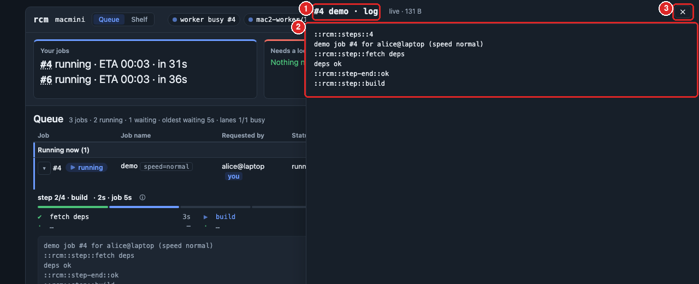

1. 어떤 작업을 보고 있는지.
2. 로그 본문. 도는 동안 계속 따라간다.
3. 닫기(Esc 도 된다).

### 최근 결과

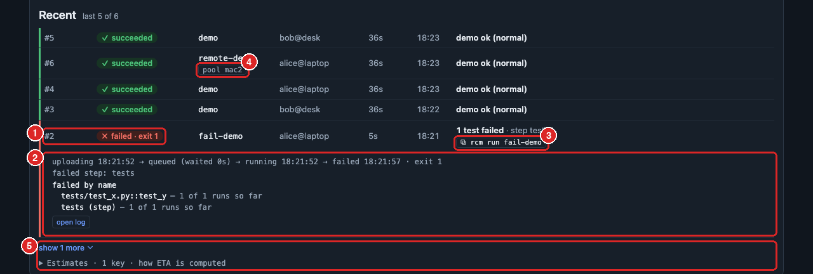

1. 최근 작업들의 **작업 번호**와 **결과**. 큐에서 보던 그 `#412` 그대로다 — 끝난 작업도 로그와
   산출물을 받아 갈 때 같은 번호를 쓴다.
2. 실패한 것을 누르면 스크립트가 **실패로 선언한 단계**이, 선언이 없으면 **끝났을 때 어디였는지**가
   보이고, 그 작업이 지목한 이름들이 최근 몇 번 빨갰는지도 함께 보인다.
3. **그대로 다시 돌리는 명령.** 복사하면 된다.
4. 어느 **풀**에서 돌았는지.
5. **Estimates** 가 ETA 의 근거를 설명한다. 표본이 몇 개고 얼마나 오래된 것인지.

### 호스트 카드

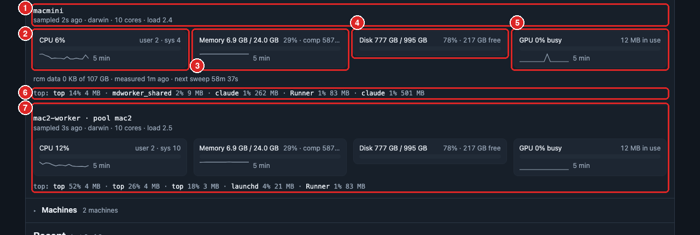

이 절은 평소 접혀 있고, 제목 옆 한 줄이 어떤 머신들이 보고 중이고 상태가 어떤지 — 「바쁨」까지 —
늘 말해 준다. 저절로 펼쳐지는 것은 **손을 대야 하는 일**뿐이다: 표본이 낡았거나, 호스트를 못
읽거나, 디스크가 10 GiB 밑으로 남았을 때. 바쁜 머신은 빌드 머신이 일하고 있다는 뜻이라 부하만으로는
펼치지 않고, 읽고 있는 중에 화면이 절을 도로 접지도 않는다 — 닫는 것은 사람의 일이다. 직접
여닫으면 그 선택을 기억한다.

1. 어떤 머신이고 **표본이 얼마나 오래됐는지**. 오래된 값은 그렇다고 적히지, 조용히 최신인 척하지
   않는다.
2. **CPU**, 3. **메모리**, 4. **디스크**, 5. **GPU**. CPU·메모리·GPU 에는 5분치 이력이 붙는다.
   GPU 를 못 읽는 머신은 0 이 아니라 「못 읽는다」고 말한다. 디스크는 작업이 실제로 쓰는 파일
   시스템이고, 얼마나 남았는지는 막대 옆에 글자로 적힌다. 빌드는 바쁜 디스크보다 **꽉 찬**
   디스크에서 먼저 죽는다.
6. **무거운 프로세스들.** 보통 이걸로 무엇이 자원을 뺏는지 알 수 있다.
7. **원격 워커**는 자기 풀 아래 자기 카드를 갖는다.

### 워커가 멈추면

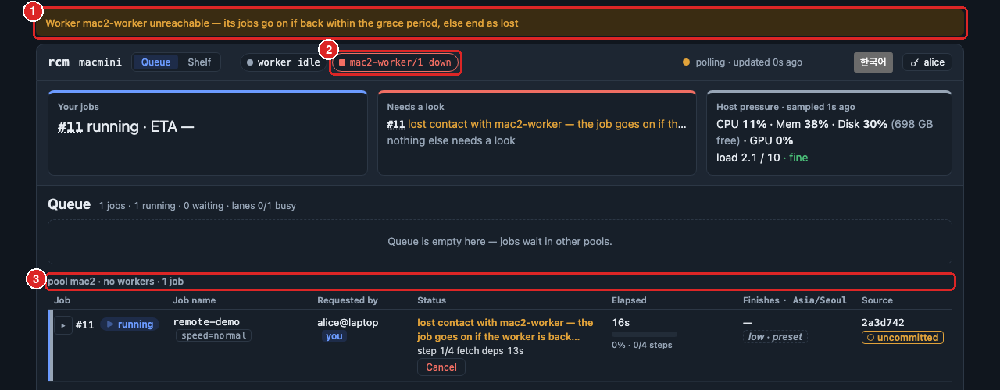

1. **띠**가 무슨 일인지 말한다.
2. 그 워커의 필이 **down** 으로 바뀐다.
3. 그 풀은 워커 없음으로 표시되고, 거기 작업들은 그 이유와 함께 **ETA 없이** 기다린다. 곧 시작할
   것처럼 굴지 않는다. 자동으로 재개되지도 않는다. 워커가 돌아오면 다시 내면 된다.

### 폰에서

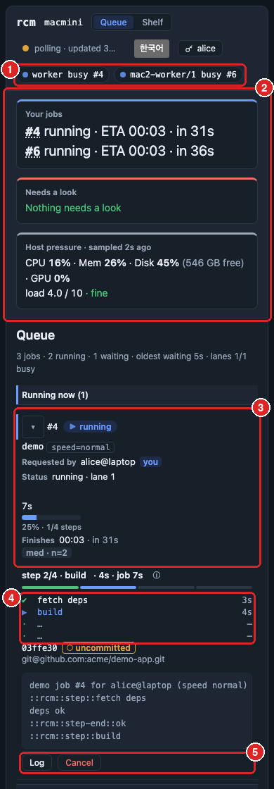

1. 워커, 2. 요약, 3. 카드가 된 작업, 4. 그 단계, 5. 버튼. 한 열에, 같은 정보를, 가로 스크롤 없이.

### 스토어 탭: 비밀 설정, 버전, 드래프트

`server.toml` 의 저장소에 `[repos.<name>.release]` 프로파일이 있으면 머리에 **Queue | Store**
전환이 생기고 `#/store/<name>` 이 스토어 탭을 연다. 프로파일이 없으면 탭도 없다. 스토어 앞에는
**설정 관문**이 있다: 필수 비밀이 전부 있고 검증되기 전에는 설정 화면이다 — 빨간 띠
`n of m secrets set · k verified`, 프로파일이 선언한 비밀마다 한 행(파일은 끌어다 놓고, 값은
password 칸에 한 번 입력), **Verify all**, 비활성 **Enter Store** — 그리고 브라우저는 값을 보지
않는다. `present` · 지문 · 검증 시각뿐이다.

관문을 지나면 탭은 **버전 목록**이다. 한 줄짜리 상태 띠가 «지금 이 앱을 올릴 수 있는가» 에만
답하고(자격 증명 · 소스 · 스토어 · 막힘) 하나라도 빨가면 띠가 빨개진다. 띠를 누르면
`#/store/<name>/status` 가 열리는데, 접히는 행 넷(Setup, Source, Build · upload, Store)과 심사
패널이 거기 그대로 있다 — 패널은 이제 **Validate listing** 과 **Plan review** 만 누를 수 있는
읽기 전용이다. `status` 프리셋이 있으면 패널에 두 스토어의 심사 상태도 나온다. 상태는 여덟 낱말
가운데 하나이고 그 밖의 값은 `unknown` 으로 그린다. 스토어의 원래 낱말을 옆에 두고 몇 분 전에
조회했는지와 그것이 `plan_max_age_minutes` 보다 오래됐는지를 보인다. **새로 조회**는 그 프리셋을
한 번 더 돌린다. 띠 아래에는 **+ 새 버전 만들기**, 그리고 열려 있는 드래프트마다 상태 · 만든 지 ·
바꾼 필드 수 · 빌드 유무 · 만료 여부가 한 행씩, 그 아래 라이브 버전과 제출한 지난 버전 20개가 있다.

**+ 새 버전 만들기**는 **이름만** 묻는다. 스토어마다 체크박스와 칸이 있고 칸에는 다음 이름이
미리 들어간다 — 플랜의 `next_version_hint`, 없으면 라이브 이름의 마지막 숫자 +1. 체크를 끄면 그
스토어는 요청에서 빠지고, 이름이 `major.minor.patch` 꼴이면서 라이브보다 커지기 전까지
**만들기**는 닫혀 있으며 이유가 칸 아래에 뜬다. 이미 열린 드래프트가 쓰는 이름이면 그 드래프트로
가는 링크가 돌아온다. 두 스토어는 **서로 다른** 이름을 가질 수 있고(App Store 1.1.1 ·
Google Play 1.0.1) rcm 은 둘을 끝까지 따로 옮긴다.

드래프트에는 자기 주소가 있다 — `#/store/<name>/v/<id>`. 두 스토어를 심사 패널과 같은 그룹
순서로 나란히 놓고, **문안 칸은 전부 편집할 수 있으며 이전 버전 값으로 채워져 있다**. 칸마다 그
값이 어디서 왔는지 적힌다(«이전 버전 그대로» · «내가 고친 것» · «파일에서»). 글자 수는 스토어
상한에 대고 세고, 달라지는 순간 «바뀜» 칩과 **되돌리기**가 붙고, 타이핑을 멈추고 800 ms 뒤 바뀐
키만 실어 저절로 저장한다. 배지는 «자동 저장 · 12s 전», 실패하면 사유와 **다시 저장**을 보이고,
어느 쪽이든 입력한 글은 화면에 남는다. 상한을 넘겨도 저장은 되고 카운터가 빨개진다 — 최종 판정은
스토어의 몫이다. 스크린샷 · 빌드 · 출시 설정 · 심사 정보는 보여 주기만 하고, rcm 은 스크린샷
파일을 건드리지 않는다. admin 토큰이 없거나 제출·폐기된 드래프트면 화면 전체가 읽기 전용이 되고
한 문장이 이유를 말한다.

그 페이지 맨 아래에는 **바텀시트**가 붙는다 — 제품에서 하나뿐이고, 진행과 남은 것과 **심사
제출** 버튼을 들고 있다. 접히면 한 줄이다: «심사 전에 남은 것 3 · 빌드 아직 없음», «S5 시나리오
QA · 10단계 중 7번째 · 66% · 경과 38m · 예상 21:40», «제출 준비됨 · 심사 플랜 4m 전 · 빌드 181»,
«제출됨 21:52 · 심사 대기». 펼치면 막대, 단계 칩(프로파일에 드라이버가 있으면 `V S0…S8`, 없으면
이번 회차의 작업들), 근거 문장, 그리고 두 열 — **심사 전에 남은 것** 과 **이전 버전과 달라진 것**
— 이 붙는다. 앞 열의 각 줄은 고치는 곳의 이름이고, 누르면 그리로 간다. 제출 조건도 여기 있다:
스토어 체크박스, 제출마다 새로 체크하고 기억하지 않는 관리형 게시 칸, 그리고 빌드 번호(**자동**
이면 플랜의 번호, **직접 입력**이면 그 번호와 정확히 같아야 한다). 퍼센트는 분모를 미리 선언한
경우에만 나오고, 아니면 막대에 빗금이 그어지고 그 사실을 적는다. 승인됐다고 저절로 출시되지
않는다. 출시는 사람이 버전과 빌드 번호와 시각을 적어 요청할 때만 돈다. 그 자리는 버전 페이지의
「출시 예약」이고, 그 스토어가 승인했다고 말한 뒤에만 열린다. `unsafe_release_type` 판정은 닫을 수
없는 빨간 띠가 된다.

드래프트는 쌓이지도, 모르는 새 사라지지도 않는다. 아무도 손대지 않은 것은 `version_ttl_hours`
(기본 24)가 지나면 버려진다 — 프로파일에 `version` 프리셋이 있으면 스토어까지, 없으면 rcm 안에서만.
반대로 **고친 적이 있는** 드래프트는 «만료»로 표시만 하고 사람이 정리할 때까지 기다린다. 그리고
심사 작업 · 업로드 작업 · 드라이버 회차 중 하나라도 살아 있으면 그 드래프트는 버릴 수 없고, 행이
무엇이 붙잡고 있는지 말한다.

상태 화면에서, 프로파일에 드라이버가 있으면 Build · upload 행에 회차의 스테퍼 S0~S8 이 드라이버의
상태 줄에서 읽혀 붙는다(도는 것이 없으면 버전 · Android 트랙 · dry-run 의 Start 폼, 도는 중엔
**Abort**, exit 1 뒤엔 **Retry same version**, exit 3 은 «결과 모름 — 다시 올리지 않음», exit 4 는
스토어 드리프트). S2 대화상자는 빌드 번호를 다시 타이핑해야 `confirm` 을 보내고(**빌드 번호:
자동** 이면 서버가 플랜의 번호로 스스로 확인해 회차가 멈추지 않는다), **Rehearsal (no upload)**
버튼은 업로드 프리셋을 예행으로만 돌린다 — 진짜 업로드는 드라이버의 S7 이고 업로드 버튼은 없다.
Source 행에는 미러의 최근 커밋 다섯 · 태그 · «PR list: next» 가 있다.

### 스토어 탭: 심사 상태와 출시

프로젝트를 스토어 탭에 어떻게 잇는지는
[README](../README.ko.md#스토어-탭--프로젝트의-릴리스-흐름-연결)와
[릴리스 계약](release-contract.md)에 있다. 빌드가 심사에 들어간 뒤에는 두 곳을 보면 된다. 아래
그림은 예시 데이터(앱 이름 `app`, 버전 1.0.x)로 그렸다.

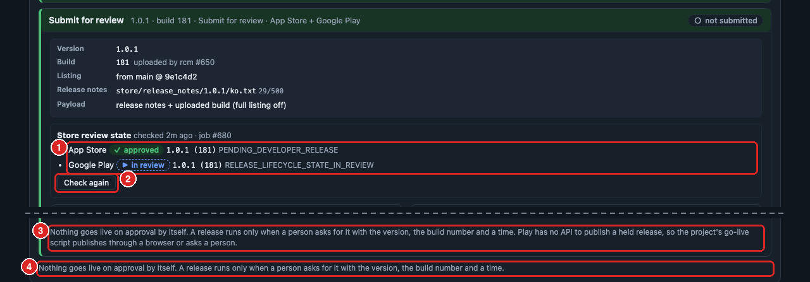

1. **스토어 심사 상태**는 읽기만 한다. 스토어마다 상태를 여덟 낱말 가운데 하나로 보이고(그 밖의
   값은 `unknown`), 버전과 빌드, 스토어가 쓴 원래 낱말을 옆에 둔다. 윗줄은 언제 읽었는지 말한다.
   그 나이가 `plan_max_age_minutes` 를 넘으면 움직이기 전에 다시 조회하라고 적는다.
2. **새로 조회**(Check again)는 프로젝트의 `status` 프리셋을 한 번 더 돌린다.
3. 패널 안의 **원칙 문장**이다. 승인됐다고 저절로 출시되지 않는다. 출시는 사람이 버전과 빌드
   번호와 시각을 적어 요청할 때만 돈다. Google Play 에는 보류한 출시를 게시하는 API 가 없어서,
   프로젝트의 출시 스크립트가 브라우저로 게시하거나 사람에게 맡긴다.
4. 같은 원칙 문장이 스토어 탭의 화면마다 맨 아래에 있다.

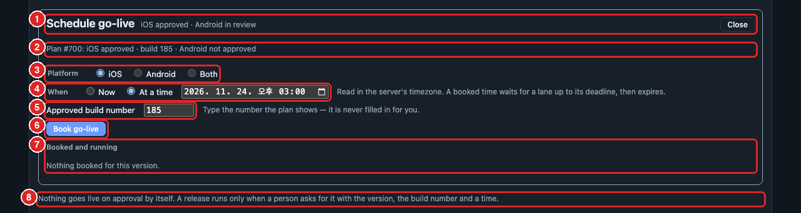

1. 버전 페이지의 **출시 예약**(Schedule go-live)은 스토어가 이 버전을 승인했다고 말한 뒤에만,
   그리고 admin 토큰이 있을 때만 열린다. 머리에 두 스토어의 상태가 한 번 더 나온다.
2. 열면 읽기만 하는 **plan** 이 먼저 돈다. 어느 스토어가 어느 빌드를 승인했는지 읽는다. plan 으로는
   아무것도 출시되지 않는다.
3. **플랫폼**은 승인된 스토어만 고를 수 있다. **Both** 는 둘 다 승인됐을 때만 고른다.
4. **지금, 또는 정한 시각.** 시각은 서버 시간대로 읽는다. 예약한 시각이 되면 lane 을 시작 마감까지
   기다리고, 그때까지 못 집히면 만료된다.
5. **승인된 빌드 번호는 사람이 직접 친다.** 자동으로 채워지지 않고, plan 의 번호와 같아야 한다.
6. **출시 예약**(Book go-live, 지금이면 Go live now) 버튼이 요청을 보낸다. 서버가 plan 과 그 나이와
   번호를 다시 확인한다([출시](configuration.md#going-live-golive)).
7. **예약과 실행 중**(Booked and running)에 이 버전에 걸린 예약이 **취소** 버튼과 함께 나온다.
8. 영역 아래에 원칙 문장이 한 번 더 있다.

## 11. 두 번째 컴퓨터

빌드 머신 한 대는 줄이 하나뿐인 큐다. 두 번째 컴퓨터(사무실의 MacBook, Linux 상자)는 **워커**로
붙는다. 같은 큐에서 작업을 가져가고, 세션 쪽은 아무것도 바뀌지 않는다.

빌드 머신에서 워커 토큰을 만든다. 한 번만 찍히고, 그 다음 줄에 새 컴퓨터에서 칠 명령이 나온다.

```sh
rcm token add mbp --worker
```

새 컴퓨터에 rcm 을 깐다. 0.8.0 이상은 세션처럼 서버 버전을 스스로 따라간다. 그보다 옛 버전이면
서버와 같은 릴리스여야 한다. 그다음에 이렇게 친다.

```sh
rcm init worker                  # ~/.config/rcm/worker.toml — server = "auto" 면 스스로 찾는다
export RCM_WORKER_TOKEN=<그 토큰>
rcm worker --check               # 서버 · 토큰 · 지문 · 돌릴 수 있는 프리셋 수
rcm init worker --service-file ~/Library/LaunchAgents/com.remote-ci-monitor.worker.plist
```

`rcm setup --role worker --server http://macmini.local:8787 --pool default --lanes 1 --yes` 는 위의
첫 명령과 마지막 명령을 한 번에 한다. `worker.toml` 과 서비스 파일을 쓰고, 그 서비스를 설치하고
띄우는 줄을 찍는다. 서비스를 띄우기 전에 토큰을 그 `worker.toml` 에 `token = "…"` 으로 넣는다.
서비스는 내 셸의 `RCM_WORKER_TOKEN` 을 보지 못한다. 그다음 `rcm doctor --role worker` 가 이 머신에
올 프리셋마다 `ready` · `needs check` · `missing` 을 붙이고, 코디네이터의 `[[tools]]` 에 있는 설치
안내를 함께 찍는다. 올 프리셋이 하나도 없으면 종료 1 이다. 풀을 잘 본다. `--pool` 없는
`rcm init worker` 는 호스트 이름을 풀 이름으로 쓰고, 그런 워커는 `placement = "any-capable"`
프리셋만 받는다.

마지막 명령은 launchd 파일(Linux 면 systemd 유닛)을 쓰고, 그것을 띄울 명령 한 줄을 찍는다. 그때부터
워커는 자기 환경을 재서 보고한다. 서버를 올리면 돌고 있던 워커는 다음 heartbeat 에서 새 버전을
알아챈다. 새 작업은 받지 않고 받아 둔 작업을 끝까지 마친 뒤 같은 프로세스에서 서버 버전으로 다시
시작한다. 새로 뜨는 워커도 먼저 서버에 버전을 묻고, 다르면 같은 방식으로 서버 버전으로 다시 시작한다. 서버가 버전이 달라 등록을
거절할 때도 그때 따라간다. 따라가지 못하면 이유를 말하고 종료 2 로 끝나고, 서비스가 다시 띄운다.
설치한 버전을 그대로 쓰려면 `RCM_CLIENT_VERSION=installed` 를 두거나 `rcm worker --no-follow` 로
띄운다([remote workers](operating.md#remote-workers)). 아무 세션에서 `rcm machines` 를 치면 머신마다 찾은 도구 버전과
돌릴 수 있는 프리셋 수, 나머지는 왜 안 되는지(`18 fvm missing`)가 나온다.

어떤 작업을 가져가는지는 프리셋이 정한다. 풀에 묶인 프리셋은 그 풀에서만 돌고,
`placement = "any-capable"` 인 프리셋은 도구를 갖춘 아무 머신에서 돈다
([Which machine runs a job](configuration.md#which-machine-runs-a-job)). 대기 이유 두 가지가
새로 생겼다. 둘 다 코드가 아니라 머신 이야기다.

- **`no capable machine — mbp: fvm missing · mac2-worker: down`**(웹: `실행 가능한 머신 없음`) — 지금
  이 프리셋을 돌릴 수 있는 머신이 없다. 머신마다 이유를 단다. 제출할 때 `rcm run` 도 같은 줄을
  찍었다. 작업은 ETA 없이 큐에 남아 있다가 머신이 고쳐지면 스스로 시작한다. 도구를 깔면 워커가
  `probe_interval_seconds`(10분) 안에 다시 보고한다. 바로 보고하게 하려면 워커를 재시작한다.
- **`check failed — mbp: sim-check failed #3620`**(웹: `머신 점검 실패`) — 이 프리셋에는 점검(머신이
  제대로 도는지 증명하는 프로젝트 스크립트)이 필요한데, 그 머신의 환경이 바뀐 뒤 점검이 실패했다.
  `rcm machines --machine mbp` 가 무엇이 바뀌었는지(`xcode 26.5 → 27.2`), `rcm logs 3620` 이
  점검이 왜 실패했는지 보여 준다. 머신을 고친 뒤 `rcm recheck mbp sim-check`(관리자)를 치거나 웹
  화면 머신 표의 **다시 점검**을 누른다. 머신 이름은 워커 토큰 이름이고, 빌드 머신 자신의 레인은
  `@local` 이다. `check pending`(웹: `점검 중`)은 점검이
  지금 도는 중이라는 뜻이다. 기다리면 된다.

## 12. 그다음

- 팀에 진짜 필요한 프리셋을 쓴다: [Configuration](configuration.md). 프로젝트의 프리셋은
  `server.toml` 이 `include` 로 들이는 따로 된 파일에 둘 수 있다
  ([presets in their own file](configuration.md#presets-in-their-own-file-include)).
- 재시작 없이 프리셋을 바꾼다: 파일을 고치고 `rcm reload --dry-run` 으로 어느 프리셋의 어느 키가
  바뀔지 본 다음(이름만, 값은 안 나온다) `rcm reload` 로 적용한다
  ([change a preset without a restart](operating.md#change-a-preset-without-a-restart)).
- 작업을 둘씩 돌린다. `[server] lanes = 2` 로 두면 레인 2 는 머신에 CPU 여유가 있을 때만 작업으므로
  올려 봐도 안전하다. 큐가 `부하로 대기` 라고 하면 머신이 꽉 찼다는 뜻이다:
  [Parallel lanes](configuration.md#parallel-lanes-without-overloading-the-machine).
- 스크립트가 단계 마커를 찍게 한다. 그래야 큐가 「도는 중」 대신 진행을 보여 준다.
- CI 스크립트에서 `rcm run` 을 감싸고 종료 코드로 분기한다. `examples/session/ci-gate.sh` 가
  동작하는 예시다.
- 재부팅을 넘겨 서버를 살려 두고, 네트워크에 열기 전에 보안 항목을 읽는다:
  [빌드 머신 운영](operating.md).
