# Usage guide

Your first job on rcm, from an empty machine to a green exit code. Every screenshot is numbered;
the numbers in the text point at the boxes in the picture above them.

The same guide in Korean: [사용법 가이드](usage.ko.md).

**Contents** — [1. What you need](#1-what-you-need) · [2. The build machine](#2-the-build-machine) ·
[3. Your machine](#3-your-machine) · [4. Your first job](#4-your-first-job) ·
[5. Not waiting](#5-not-waiting) · [6. When it fails](#6-when-it-fails) ·
[7. Two sessions, one tree](#7-two-sessions-one-tree) ·
[8. Getting the files back](#8-getting-the-files-back) ·
[9. The whole queue](#9-the-whole-queue-in-one-screen) · [10. The web page](#10-the-web-page) ·
[11. A second machine](#11-a-second-machine) · [12. What to do next](#12-what-to-do-next)

## 1. What you need

- A **build machine** that stays on: a Mac or a Linux box, with Python 3.11.4 or newer.
- Any number of **session machines** — the laptops and desktops that will send work. Same Python
  requirement, and a route to the build machine (the same Wi-Fi is enough).
- Five minutes.

Install the same package on both. It has no runtime dependencies:

```sh
pipx install git+https://github.com/monocsp/remote_ci_monitor
```

## 2. The build machine

Three commands: write a config, make a token, start the server.

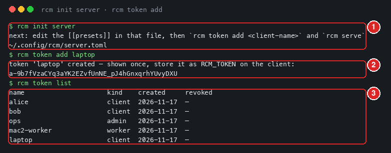

1. **`rcm init server`** writes `~/.config/rcm/server.toml` and prints where it went. Open it and
   replace the example preset with the command your team actually runs, then set
   `bind = "0.0.0.0"` if sessions come from other computers.
2. **`rcm token add laptop`** prints a token **once**. Copy it now: the server keeps only a hash of
   it and cannot show it again. One token per machine, so you can revoke one without disturbing
   the rest.
3. **`rcm token list`** shows names, kinds and dates, never secrets. `rcm token add ops --admin`
   makes an admin token; `rcm token revoke laptop` kills one.

Then start it:

```sh
rcm serve      # http://127.0.0.1:8787 · Ctrl-C stops it cleanly
```

Leave that terminal alone for now. To keep it running after you log out, use the service files in
[Operating the build machine](operating.md#run-as-a-service).

## 3. Your machine

The session needs to know two things: **where** the server is, and **who you are**. Only the first
one can be automatic, and the difference is worth knowing before you start.

On the same network you do not have to answer the first one. Ask what is out there:

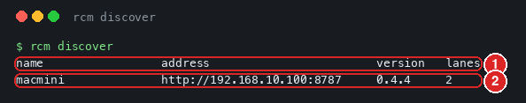

1. The header names the columns: server name, address, version, lanes.
2. One line per server. If exactly one shows up, you can leave `server` out of your config
   entirely and rcm will use it. Nothing found? The server is on another network, or its
   `advertise` is off — put its address in the file by hand.

Leaving `server` out needs rcm **0.2.2 or newer on both machines**. An older client has no
discovery at all: it stops with `no server configured` and, unlike `rcm worker`, it never compares
its version with the server's, so nothing points at the real cause. When in doubt, write the
address (`http://<build-machine>.local:8787`) — it costs nothing and always works.

**The token is not discovered, and never will be.** `rcm token add` runs on the build machine and
writes straight to the server's database; no API hands one out. Somebody has to carry it over. So
on a fresh machine this is the normal, correct state:

```
ok    server    v0.2.3 (found on this network)
FAIL  token     no token
ok    presets   gate, gate-smoke, ...
ok    pools     default (1 lane)
```

Three green rows and one red one. The server is open enough to show you its queue without a token
(`read_auth = "none"`), which makes it look finished. It is not: every write needs the token, and
copying it over is the one step left.

Write `~/.config/rcm/client.toml`. It holds a token, so it must not be readable by others:

```sh
mkdir -p ~/.config/rcm && cat > ~/.config/rcm/client.toml <<'EOF'
server = "http://macmini.local:8787"   # leave this line out on the same network
token = "<the token from step 2>"
label = "alice@laptop"                 # who the queue will show as the requester
EOF
chmod 600 ~/.config/rcm/client.toml
```

Now prove the whole path before you trust it with real work:

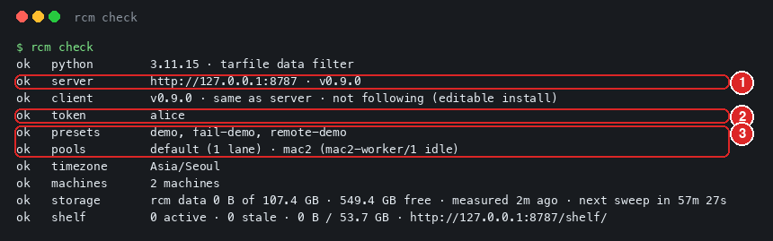

1. **server** — the address it used and the version it answered with. A version far from yours is
   worth fixing; `rcm worker` refuses a mismatch outright. Your `rcm` follows the server by
   itself: when the server runs another version, the next command downloads the server's own
   wheel (`/client/remote_ci_monitor-<version>-py3-none-any.whl`), prints
   `rcm: following server v…` once and runs that code. The `client` row below says so
   (`following (installed v…)`), or says why it did not follow and prints the one command that
   installs the server's wheel by hand. `RCM_CLIENT_VERSION=installed` (or `--no-follow` for one
   command) keeps the installed rcm, and `--help` always shows the installed rcm's help. See
   [keeping clients on the server's version](operating.md#keeping-clients-on-the-servers-version).
2. **token** — the name your token belongs to, and whether it is an admin token. `FAIL` here means
   the token is wrong or revoked, and nothing else will work.
3. **presets and pools** — what this server offers, and whether anything can actually run. A pool
   with no live worker is the reason jobs would sit still forever.

Every row must say `ok`. A `warn` row is a heads-up, not a failure: `rcm check` still exits 0.

## 4. Your first job

`rcm run` sends the directory you are standing in, waits, and gives you the answer.

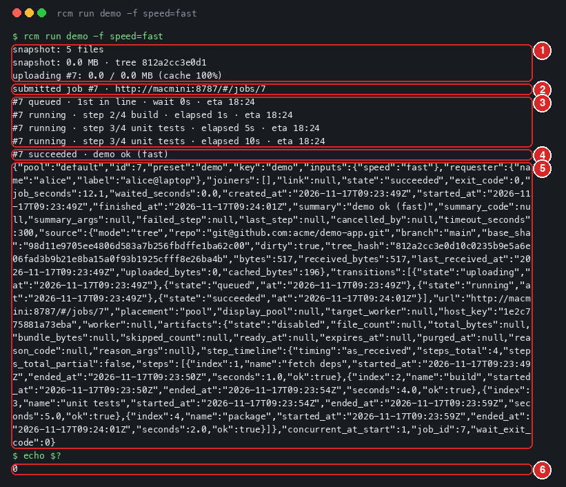

1. **The snapshot.** Everything git tracks plus untracked files that are not ignored, minus your
   `.rcmignore` patterns. It says how many files and how big, and how much it actually had to
   upload — the server keeps what it has already seen, so the second run of a barely-changed tree
   sends almost nothing.
2. **The job number and its URL.** Open that link and you are looking at this job in the web page.
3. **Progress**, one line per step, with the elapsed time and the estimated finish. The step names
   are whatever your script prints with `::rcm::step::…`.
4. **The verdict**, with the one-line summary your script printed.
5. **One JSON line on stdout** — everything about the job: state, timings, steps, the failed step
   if any. Everything above this was on stderr, so `rcm run … | jq` gets just this.
6. **The exit code**, which is what a script should branch on. 0 means it passed.

## 5. Not waiting

`--no-wait` submits and returns immediately. Come back to it whenever you like.

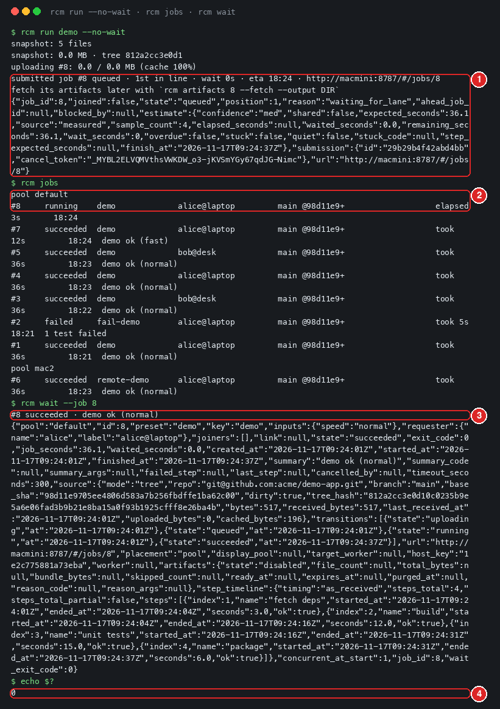

1. **Submit and go.** The line names the job, its state, where it is in line and when it should
   finish; the JSON repeats that as `position`, `reason` and `estimate`. A job that is
   already running has no position, so that part is absent rather than guessed, and a queue that
   cannot start at all — paused, or a pool with no live worker — gets no finish time either,
   because there is none to give. If the queue cannot be read the position is missing and
   the exit code is still 0: `--no-wait` exits 0 because the job was submitted,
   not because it was looked up.
2. **On a machine that is short on memory**, make this the default: `rcm run --no-wait` prints
   the job number and returns, and `rcm wait --job N` attaches whenever you like. A waiting client
   is small — tens of megabytes, and it no longer grows with the size of the tree while it waits —
   and idle, but it is still a process sitting there for the length of a
   build, and if the operating system kills it the shell sees 137 — which is *not* the job
   failing. The job keeps running on the build machine; attach again and you get the real answer.
3. **`rcm jobs`** lists what is queued, running and recently finished, grouped by pool, with who
   asked for it and how long it took.
4. **`rcm wait --job N`** attaches to a job you already have, follows it over the event stream and
   ends when the job does. Ctrl-C detaches again without stopping anything.
5. The exit code is the job's, exactly as if you had waited from the start.
6. Its end line says where the job ran and how long it took:
   `#381 succeeded on build-02 · 6m 31s · artifacts ready`. Warning, log and shelf lines may
   follow it. A failed job adds the step that failed (`· step test`); the artifact state is left
   out when the preset declares no artifacts, and a job that never started says nothing about
   artifacts.
   Artifacts that `failed`, were `dropped`, are `unavailable` or `unknown` add a warning line,
   and artifacts still `collecting` or `uploading` add
   `#381 artifacts still collecting (uploading) — see them later with rcm artifacts 381`. Neither
   changes the exit code. The JSON carries the same machine as `ran_on` (`worker` stays `null`
   for the build machine's own lanes, as before). For those lanes `ran_on` is the server's host
   name as it is now, not as it was when the job ran.
7. **`rcm wait --job N --notify`** also shows a desktop notification on the computer that waits
   when the wait ends, after the JSON line — `osascript` on macOS, `notify-send` on Linux.
   Without the tool, or on Ctrl-C while it runs, it prints one warning line and exits as it
   would have. It is off unless you pass it, and `rcm run` does not take it: run with
   `--no-wait`, then wait with `--notify`.

**Later instead of now.** `rcm run deploy --ref main --at 15:00` (or `--in 90m`) hands the server
a time. The job waits as `scheduled` and enters the queue at that time: `rcm jobs` lists it as
`at 15:00`, and `rcm wait --job N` prints `scheduled for 15:00 · start by 15:15` and keeps
waiting. If no lane picks it up within its start deadline (15 minutes unless the preset sets
another) it ends `expired`, exit 2 — it did not run. The rules are in
[running a job later](configuration.md#running-a-job-later---at-and---in).

**Again later.** A preset with a `[presets.retry]` table runs its script again when it exits 75
("not yet"), every `interval_seconds`, up to `max_attempts`. Each attempt is a job of its own:
`rcm wait --job N` prints `#57 exit 75 · attempt 1 of 12 · retrying as #58 — waiting for it` and
follows the chain to its end; the last attempt's `exhausted` is exit 1. `rcm cancel` with any id
of the chain stops it. The rules are in
[trying again later](configuration.md#trying-again-later-presetsretry).

`rcm logs N` prints the log, `rcm logs N --follow` keeps printing until the job ends, and
`rcm cancel N` stops it.

**When the job needs a person.** A script that cannot go on by itself — a sign-in expired —
prints `::rcm::action::<code>::<note>`. `rcm wait` then prints
`#412 needs action · login · Sign in on the build machine` on stderr, and the job's row says
`needs action`. `rcm wait --job N --return-on-action` returns at that moment with exit 4 and the
JSON, `action` included, while the job keeps running — a session that waits for the result gets
its turn back and can ask the person. Once the person has acted, wait again **without** the flag:
the action stays on the job, so the flag would return at once
([details](configuration.md#when-a-person-has-to-act)).

`rcm cancel N` sends the cancel token that came back with the submission — `rcm run` saved it in
`~/.local/state/rcm/submissions.json` (`$XDG_STATE_HOME/rcm/submissions.json` if set, mode
0600), so the session that submitted can cancel and a session in another state directory — a
different user, or a different machine — cannot, even with the same client token. Two sessions of
the same user share that file: `rcm cancel N` then sends the token of the **newest** submission
of that job made with this client token — never one another token saved — so a session that
joined only leaves the join list and never cancels the job; pass
`--submission-id` (the `submission.id` from the `--no-wait` JSON) to pick a specific one. From
another machine, or from a wrapper that kept the `--no-wait` JSON (it carries
`submission.cancel_token`), pass it with `--cancel-token`: `rcm cancel N --cancel-token …`. Without either, the
command says so and still sends the cancel: a server on the default settings accepts it as before,
a server with `cancel_requires_submission_token = true`
([configuration](configuration.md#who-may-cancel-a-job)) answers 403 unless the token is an
admin token. A token that worked is removed from the file; the file keeps the newest 200 entries
and, above that, drops only jobs the server says are finished. If the file cannot be written,
`rcm run` says so in one line and the job runs anyway — cancel it with `--cancel-token`. The cancel
token is never printed anywhere else, and neither is the path of the state file.

## 6. When it fails

A failed job is not an error in the tool, so the output stays calm and specific.

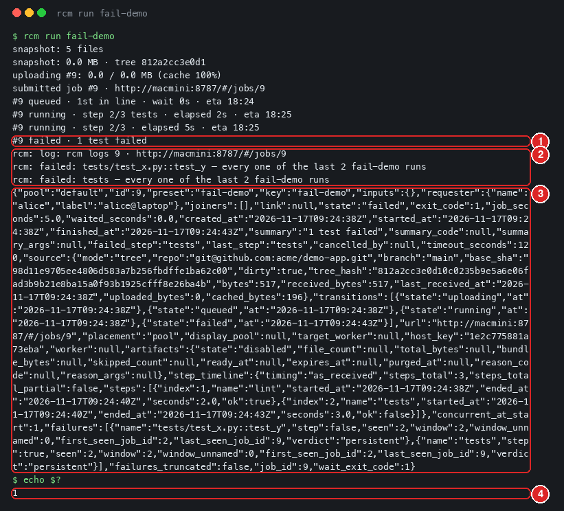

1. **The verdict line** names the step that failed — but only when your script said so, with
   `::rcm::step-end::fail` or `::rcm::fail::<name>`. Without a declaration rcm does not guess: it
   shows `last step <name>`, which says where the job was when it ended and claims nothing about
   the cause. A script that runs several things in parallel and replays their logs afterwards
   would otherwise have the last replayed heading blamed for a failure that happened earlier.
   When your script printed no summary of its own, the summary names the first thing it reported
   instead of a bare exit code: `test: x_test.dart +1 more (exit 1)`, or `analyze failed (exit 1)`
   when it only declared the step. The same line reaches the queue, `rcm wait` and the
   notification hooks ([Saying what failed](configuration.md#saying-what-failed)).
2. **Where to look next.** Every non-zero exit prints `log: rcm logs <N>` and the job URL —
   including exit 3, where you know least. Under it, one line per name your script reported with
   `::rcm::fail::<name>`, saying how often each was red in the recent runs of the same preset:
   `2 of the last 8 gate runs · intermittent?` for something that comes and goes,
   `first time in the last 8 gate runs` for something new, `every one of the last 8 gate runs`
   for something that is simply broken. The question mark is deliberate — it is a suggestion, not
   a verdict, and the counts are next to it.
3. **The JSON** carries `failed_step`, `last_step`, `failures`, `exit_code` and the per-step
   timings, so a wrapper script can report which stage broke without scraping the log. The
   timings are `step_timeline`: one entry per `::rcm::step::` your script printed, with
   `started_at`, `ended_at`, `seconds` and `ok` — the same numbers the queue showed while the
   job ran, kept after it finished. `steps: []` means the script printed no step markers;
   `step_timeline: null` with `step_timeline_error_code` means the server could not read them.
   `concurrent_at_start` is how many jobs were running when this one started, itself included
   — a job that ran alone reads `1`, and `null` means the server does not know — the number to
   look at when you try two lanes.
   The same document is `GET /jobs/<N>`, so `rcm wait --job N` prints it too.
4. **Exit 1 means the job failed.** Exit 2 is cancelled or timed out. Exit 3 is *unknown* — the
   server restarted, or you could not reach it — and it is never reported as a failure. If your CI
   treats 3 as red, it will be red for the wrong reason. Exit 5 is a **delivery** failure and only
   appears with `--fetch-artifacts`: the job's own result is in `wait_exit_code`, and the files
   are what did not arrive ([Getting the files back](#8-getting-the-files-back)). Exit 4 only
   appears with `rcm wait --return-on-action`: the job asked a person to act and is still running
   ([Not waiting](#5-not-waiting)).

5. **A job that never started says so.** Some failures happen before your script runs, and the
   summary names which: the workspace could not be built (`snapshot_missing`,
   `snapshot_rejected`, `blob_missing`, `repo_missing`, `commit_missing`, `git_failed`,
   `snapshot_download_failed`), the process could not be launched
   (`launch_executable_missing`, `launch_permission_denied`, `launch_failed`,
   `log_unavailable`), the preset left the config while the job waited (`preset_missing`), or a
   `requires` entry was not there (`tool_missing`). All of them carry a `summary_code` and have
   `exit_code: null`, so a script can tell "my tests failed" from "the job never ran" without
   reading the sentence. These summaries carry no free text at all: the arguments are a code, a
   name already in the job, or a number. The original text — including the command that could
   not be started — is in the job log, which needs a token; the one case with nothing to read
   there is `log_unavailable`, where the log file is what could not be opened.

A cancelled job has no failed step and no last step: you stopped it, it did not break.

## 7. Two sessions, one tree

Two people testing the same commit should not queue twice.

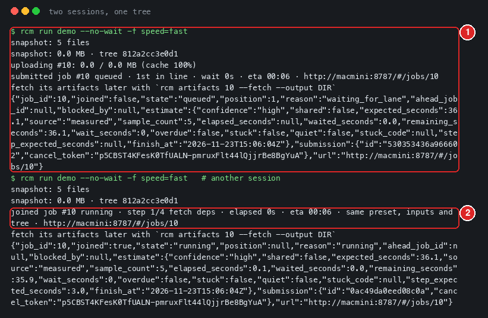

1. The first submission creates the job.
2. The second one, with the same preset, the same inputs and the same tree, **joins** it: no second
   run, no second wait, the same result for both. `--no-join` opts out, and cancelling a joined job
   only removes you from the list.

### When you push again

If the preset sets `supersede` ([configuration](configuration.md#superseding-older-jobs-of-the-same-branch)),
a new job for the same branch, preset and inputs clears your older one when it enters the queue —
no need to find it and cancel it yourself. The old job ends `cancelled` with the summary
`superseded by #57`, and a session still waiting on it gets exit code 2 and one line saying where
to look next:

```
$ rcm wait --job 41
#41 superseded by #57 — rcm wait --job 57
```

Only your own jobs are cleared, and only when nobody else has joined them. `rcm run --no-supersede`
keeps the older job for this one submission (to run a flaky test twice side by side).

## 8. Getting the files back

A job that regenerates files leaves them on the build machine. `--fetch-artifacts` brings them
home, into the same paths in the tree you submitted.

```sh
rcm run goldens --fetch-artifacts
```

```
artifacts: 64 files · 12.4 MB
artifacts: new 0 · changed 12 · unchanged 51 · conflicted 1
artifacts: wrote 12, unchanged 51, conflicted 1
```

1. The preset has to declare what to collect (`artifacts = ["test/**/goldens/*.png"]` — see
   [Configuration](configuration.md#getting-files-back-out-of-a-job)). Without it nothing is
   collected and nothing is fetched; that is not an error.
2. **A file you edited while waiting is never overwritten.** It is counted `conflicted` and left
   as it is. `--force` overwrites those too. `--dry-run` prints the table and writes nothing.
3. The last line separates what was compared from what was written. For a golden update, `wrote`
   is the answer you came for.
4. Once every file is written, your session tells the server. If nobody joined the job, the bundle
   is deleted right then; otherwise it waits 24 hours so the others can fetch it too.
5. A `git_ref` preset has no submitted tree, so `--output DIR` says where to write, and the
   baseline is empty: a file already sitting there with different bytes is `conflicted` and only
   `--force` overwrites it.
6. **The exit code says whether you got the files.** 0 means you have them — or that there were
   never any to have, because the preset declares no `artifacts` globs (`disabled`) or they
   matched nothing (`empty`). Everything else is **5**: the job has not finished yet (`pending`),
   the bundle was dropped, failed, expired or already purged, or a file on disk would have been
   overwritten and you did not pass `--force`. A job that failed still reports its own exit code
   first — a broken test matters more than a missing file.
7. `--dry-run` answers "would this apply cleanly?" with the code it would have used: 0 for a clean
   plan, 5 if anything is `conflicted`. It writes nothing either way.

Submitted with `--no-wait`, or want them somewhere else?

```sh
rcm artifacts 412                          # what is there
rcm artifacts 412 --fetch --output ./out   # write it into a directory you name
```

### Keeping them: the shelf

A bundle lives a day at most. When you want to look at the files again next week, or open them
on your phone, keep the job on the server's shelf:

```sh
rcm run golden-update --keep
```

```
#412 succeeded · 12 goldens updated
shelf: http://macmini.local:8787/shelf/412/
```

1. Open the link in any browser on the same network (or over Tailscale). The page shows the
   job, its images and a file table, and *Download as zip* takes everything. No token.
2. A preset with `keep = true` is always kept; `--keep` keeps one job of any preset that declares
   `artifacts`.
3. `rcm keep 412` keeps a job that already finished, as long as its bundle still exists. A job
   fetched with `--fetch-artifacts` loses its bundle right then, so use --keep from the start
   (both flags together work).
4. `/shelf/latest/golden-update?branch=dev` always opens the newest kept golden-update of `dev`.
   Bookmark it.
5. Nothing to clean up by hand: an item nobody opened for six months moves to *cleanup pending*,
   and after a year without use it is deleted. Opening it, downloading from it or pressing
   *Restore* starts its clock again. `rcm shelf` lists what is there; `rcm shelf rm 412` (admin)
   removes one now.

Anyone who can reach the server can open the shelf, so do not put secrets in `artifacts`
([who can open it](configuration.md#keeping-a-jobs-files-the-shelf)).

From a script, submit with `--keep --no-wait` and read the link from the output, then fetch the
files again on any computer, without a token:

```sh
rcm run app-map-shots --keep --no-wait
# submitted job #412 queued · …
# fetch its artifacts later with `rcm artifacts 412 --fetch --output DIR`
# shelf: http://macmini.local:8787/shelf/412/ (after the job finishes)
rcm wait --job 412
rcm shelf get http://macmini.local:8787/shelf/412/ --output .
rcm shelf get --latest app-map-shots --branch dev --output .
curl "http://macmini.local:8787/api/shelf/latest/app-map-shots?branch=dev"   # the same, as JSON
```

The paths stay as they were kept, so `--output .` in the project folder puts the files back
where the job made them. `rcm shelf get` checks every file's sha256 and writes nothing unless they all match. Add
`keep = true` to a preset only once the server runs v0.7.0; an older server refuses the key
([scripts](configuration.md#using-the-shelf-from-a-script)).

## 9. The whole queue in one screen

`rcm top` is the one command to leave open in a terminal.

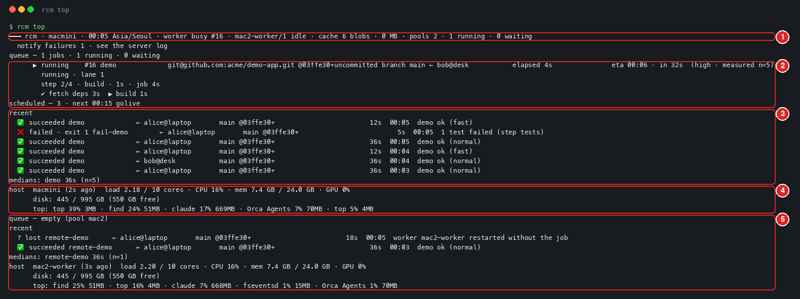

1. **The header**: which server, what time it is there, what the workers are doing, how big the
   snapshot cache is.
2. **The queue**: what is running with its current step, and what is waiting with its position and
   ETA. The reason a job is not moving is stated, never guessed.
3. **Recent results and medians** — how long this preset usually takes, from real runs, which is
   where the ETAs come from.
4. **The host**: load, CPU, memory, disk, GPU and the top processes. This is how you tell "not
   responding" from "the machine is busy".
5. **Other pools** get their own section, so a second build machine is visible from the same
   screen.

A pool with scheduled jobs adds one line, `scheduled — 2 · next 15:00 golive`.

`rcm top --watch 5` refreshes every five seconds; `rcm top --json` is for scripts.

## 10. The web page

Open `http://<build-machine>:8787/` — nothing to install, and it works on a phone.

### The header

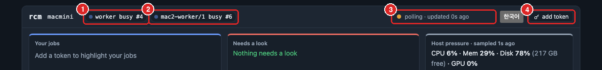

1. The **local worker** lane and what it is running.
2. Each **remote worker**, with its pool and job. A worker that stopped answering shows `down`.
3. The **connection state**. `live` means the event stream is open; `polling` means it fell back,
   with the age of the last successful update.
4. The **key button** takes your token. It is kept in this browser only, never in the URL.

### The queue

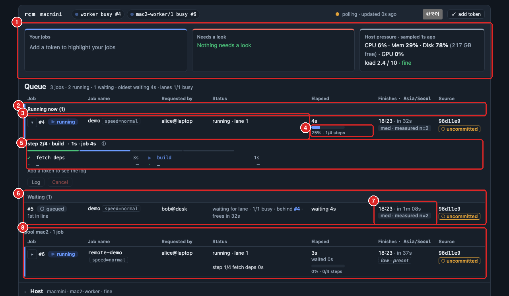

1. **Three answers at a glance**: your jobs, anything that needs a look, and how hard the machine
   is working.
2. **Running now, and waiting**, each with a count. An empty group says so rather than vanishing,
   so "nothing is running" never looks the same as "the page did not load".
3. **The running job**, with who asked for it and what tree it is testing. Rows arrive folded; the
   current step stays in the status column as `step 2/4 build 2s`, so a folded row still says what
   is happening.
4. **How far along it is**, on a short bar inside the **Elapsed** column, and — always — what the
   bar measured. `50% · 4/8 steps` when the job declares how many steps it has; `70% · by measured
   time` or `by preset estimate` when it does not, so you can see how much the number is worth.
   A job that finished every declared step but has not exited reads `4/4 steps`, and a job nothing
   can be said about — no samples at all, preparing its workspace, past its estimate, or not
   responding — reads `progress —`. The label stops there: whether the job is past its estimate,
   not responding or merely quiet is told by the bar's colour and hatching and by the status
   column, which already says it in words. Point at the bar, or read it with a screen reader, and
   the condition is spelled out in full (`50% · 4/8 steps · not responding`). A running job never
   fills the bar: a full bar means finished, and this one is still going.
5. **Its steps**, opened with **▸**, in order, with the finished ones ticked and the current one
   timed. The seconds count up as you watch; they do not sit still and then jump when the page
   refreshes. The log tail and the **Log** button are in the same block. **Cancel** does not hide
   there: it stays in the row while the row is folded, so stopping a runaway job is one tap.
6. **A waiting job**, with its position in the queue.
7. **The ETA and its confidence.** `high` is a median of five or more real runs, and `n=12` says
   how many (hover the badge for the whole sentence); `low` is a guess from the preset; `—` means
   it will not pretend to know.
8. **Another pool**, with its own workers and queue. The **Source** column shows the commit only;
   the repository it came from is in the expanded block, since every row usually repeats it.

A name longer than its column is cut in the middle (`android-integration-test-s… name-that-goes`),
so names that start the same still differ at the end. Tap or click a cut name — or Tab to it and
press Enter — to read it in full, with a **Copy** button. Tap again, tap elsewhere or press Escape
to close it. It needs no hover, so it works on a phone too.

### Scheduled jobs, and a job that needs a person

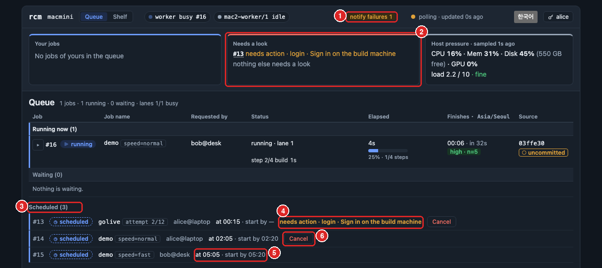

1. **`notify failures N`** in the header: a notification hook has failed since the server started.
   The count lives in the server's memory, so a restart sets it back to 0; the server log keeps
   each failure.
2. **Needs a look** names a job that said it needs a person:
   `needs action · login · Sign in on the build machine`. It comes before anything rcm inferred
   ([details](configuration.md#when-a-person-has-to-act)).
3. **Scheduled (N)**: jobs started with `rcm run --at` or `--in`, below the queue, in time order.
   If the server could not read them, this section is a red band, never an empty list.
4. **A retry attempt** waiting for its turn, `attempt 2/12`, still carrying the action the last
   attempt printed, so the chain keeps asking for the person between attempts
   ([trying again later](configuration.md#trying-again-later-presetsretry)).
5. **When it starts, and its start deadline.** A scheduled job has no ETA until it enters the
   queue; if no lane picks it up by the deadline it ends `expired`. A retry attempt has no deadline
   (`start by —`) ([details](configuration.md#running-a-job-later---at-and---in)).
6. **Cancel** on your own schedules.

### Your jobs

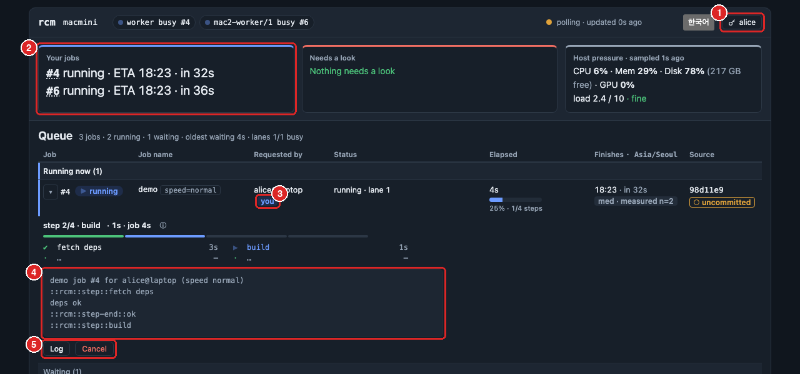

1. Paste the token behind the **key button**. The button then shows the token's name.
2. **Your jobs** in the summary counts what you asked for, including jobs you joined.
3. Your rows are marked **you**.
4. The last lines of the log appear under your running job, updating as it goes.
5. **Log** opens the whole thing; **Cancel** stops the job. You only ever see these on your own
   jobs, unless your token is an admin one.

### The log drawer

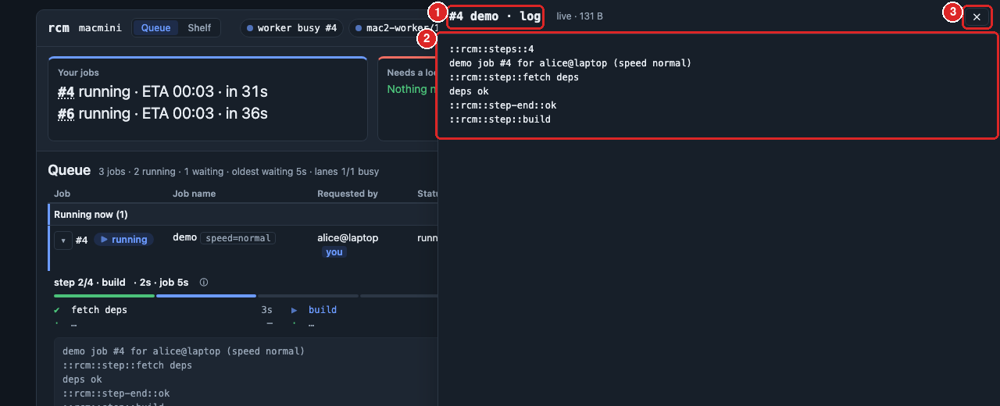

1. Which job you are reading.
2. The log itself, following the job while it runs.
3. Close, or press Escape.

### Recent results

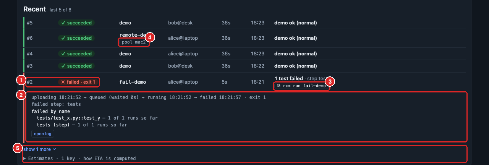

1. The **job number** and the **result** of every recent job. It is the same `#412` the queue
   showed, so a finished job is still the one you fetch the log or the artifacts for.
2. Click a failed one to see the step it declared as failed — or, when it declared none, **where
   it was when it ended** — plus every name it reported and how often each was red recently.
3. **The command that reproduces it**, ready to copy.
4. Which **pool** it ran in.
5. **Estimates** explains where the ETAs come from — how many samples, how old.

### The host card

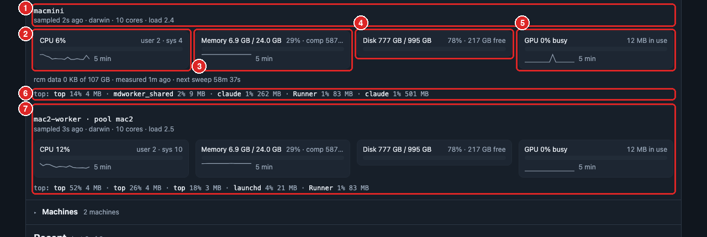

The section is folded by default, and the one-line summary beside the heading always says which
machines are reporting and how they are doing — including `busy`. It opens itself only for
something you have to act on: a sample that has gone stale, a host that cannot be read, or a disk
with less than 10 GiB left. A busy machine is a build machine doing its job, so load alone never
opens it, and the page never folds the section back up while you are reading — closing it is
yours to do. Open or close it yourself and that choice is remembered.

1. The machine and **how old the sample is**. Anything stale is labelled, never quietly shown as
   current.
2. **CPU**, 3. **memory**, 4. **disk** and 5. **GPU**. CPU, memory and GPU carry five minutes of
   history; a machine without a readable GPU says so instead of showing zero. Disk is the
   filesystem the jobs write to, and how much is left is spelled out beside the bar — a build
   fails on a full disk long before it fails on a busy one.
6. **The heaviest processes**, which is usually enough to see what else is competing for it.
7. Each **remote worker** gets its own card under its pool.

### When a worker stops

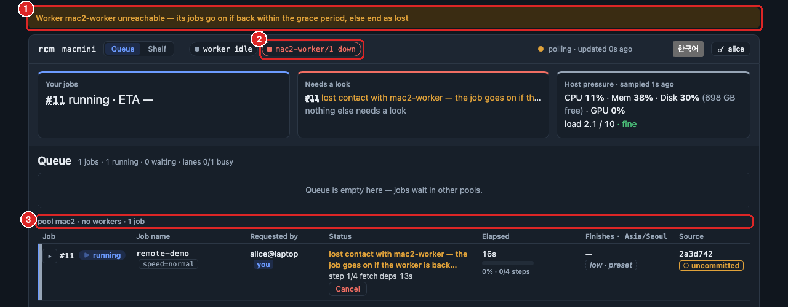

1. A **banner** says what happened.
2. The worker's pill turns **down**.
3. Its pool is marked as having no worker, and jobs there wait with that reason and **no ETA** —
   nothing pretends they are about to start. They are not resumed automatically: submit again once
   the worker is back.

### On a phone

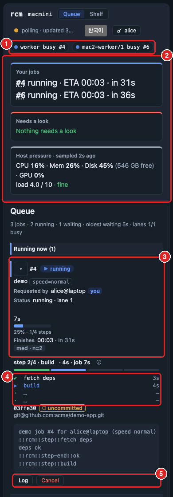

1. Workers, 2. the summary, 3. a job as a card, 4. its steps and 5. the buttons — one column, same
   information, no horizontal scrolling.

### The Store tab: review state and going live

A repository with a release profile gets a **Store** tab next to **Queue**. What it is and how a
project connects to it are in the [README](../README.md#store-tab--connecting-a-projects-release-flow)
and the [release contract](release-contract.md). Two places in it matter once a build is in review.
The pictures below are drawn from sample data (an app called `app`, version 1.0.x).

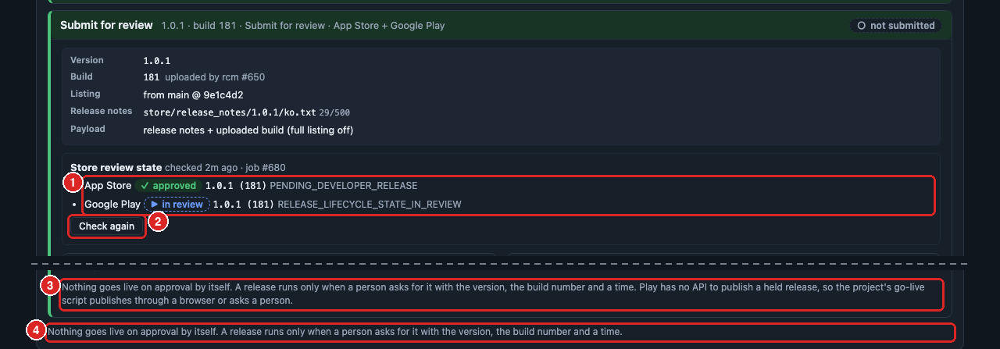

1. **Store review state**, read-only: each store's state in one of eight words (`unknown` for
   anything else), the version and build, and the store's own word beside it. The line above says
   how long ago it was read; once that is older than `plan_max_age_minutes` it asks you to check
   again before you act on it.
2. **Check again** runs the project's `status` preset once more.
3. **The rule**, in the panel: nothing goes live on approval by itself. A release runs only when a
   person asks for it with the version, the build number and a time. Google Play has no API to
   publish a held release, so the project's go-live script publishes through a browser or asks a
   person.
4. The same rule closes every Store screen.

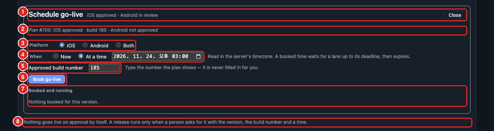

1. **Schedule go-live**, on the version page, opens only once a store says this version is approved,
   and only with an admin token. Its head repeats both stores' state.
2. Opening it runs a read-only **plan** first: which store approved which build. Nothing goes live
   from a plan.
3. **Platform**: only an approved store can be chosen, and **Both** only when both are.
4. **Now, or at a time** read in the server's timezone. A booked time waits for a lane up to its
   start deadline, then expires.
5. **The approved build number, typed by you.** It is never filled in, and it has to match the plan.
6. **Book go-live** (**Go live now** for Now) sends the request. The server checks the plan, its age
   and the number again ([going live](configuration.md#going-live-golive)).
7. **Booked and running** lists what is booked for this version, with **Cancel**.
8. The rule again, under the area.

## 11. A second machine

One build machine is a queue of one. A second computer — a MacBook in the office, a Linux box —
joins as a **worker**: it takes jobs from the same queue, and nothing changes for the sessions.

On the build machine, make a worker token. It is printed once, followed by the line to type on the
new machine:

```sh
rcm token add mbp --worker
```

On the new machine, install rcm (0.8.0 or newer follows the server's version by itself, as a
session does; an older one must be the same release as the server), then:

```sh
rcm init worker                  # ~/.config/rcm/worker.toml; server = "auto" finds the server
export RCM_WORKER_TOKEN=<the token>
rcm worker --check               # server · token · fingerprint · how many presets it can run
rcm init worker --service-file ~/Library/LaunchAgents/com.remote-ci-monitor.worker.plist
```

The last command writes a launchd file (a systemd unit on Linux) and prints the one command that
starts it. From then on the worker measures its own environment and reports it. When the server
is upgraded, a running worker sees the new version in its next heartbeat, finishes the jobs it
has without taking new ones, and starts the server's version in the same process. A worker that
starts asks the server first and, if the versions differ, starts the server's version the same
way. If the server refuses its registration for the version, it follows then too, or stops with
exit 2 and says why, and the service starts it again. `RCM_CLIENT_VERSION=installed` (or `rcm worker --no-follow`)
keeps the installed version
([remote workers](operating.md#remote-workers)). Back on any
session, `rcm machines` shows every machine, the tool versions it found and how many presets it
can run — and for the rest, why not (`18 fvm missing`).

Which jobs it takes depends on the preset. A preset tied to a pool runs only there; a preset with
`placement = "any-capable"` runs on any machine that has its tools
([Which machine runs a job](configuration.md#which-machine-runs-a-job)). Two waiting reasons are
new, and both are about a machine, not your code:

- **`no capable machine — mbp: fvm missing · mac2-worker: down`** — no machine can run this preset
  right now; each one says why. `rcm run` printed the same line when you submitted. The job stays
  queued with no ETA and starts by itself once a machine is fixed: install the tool and the worker
  reports again within `probe_interval_seconds` (10 minutes), or restart the worker to report at
  once.
- **`check failed — mbp: sim-check failed #3620`** — the preset needs a check (a project script
  that proves the machine works) and it failed on that machine after its environment changed.
  `rcm machines --machine mbp` shows what changed (`xcode 26.5 → 27.2`) and `rcm logs 3620` why
  the check failed. Fix the machine, then `rcm recheck mbp sim-check` (admin), or press
  **Recheck** in the web page's machines table. A machine is named by its worker token name; the
  build machine's own lanes are `@local`. `check pending` means the check
  is running right now, or about to; wait for it. A check that was cut off — the worker
  restarted in the middle — is not run again by itself: the row says `sim-check #3621 did not
  finish — recheck` under `check failed`, and `rcm recheck` is the way out.

## 12. What to do next

- Write the preset your team actually needs: [Configuration](configuration.md). A project's presets
  can live in their own file that `server.toml` brings in with `include`
  ([presets in their own file](configuration.md#presets-in-their-own-file-include)).
- Change a preset without a restart: edit the file, run `rcm reload --dry-run` to see which presets
  and which keys would change (names only, never values), then `rcm reload` to apply it
  ([change a preset without a restart](operating.md#change-a-preset-without-a-restart)).
- Run two jobs at once. Set `[server] lanes = 2` — lane 2 only picks up work while the machine has
  CPU to spare, so it is safe to try. If the queue says `held by load`, that is the machine telling
  you it is full: [Parallel lanes](configuration.md#parallel-lanes-without-overloading-the-machine).
- Make your script print step markers, so the queue shows progress instead of a spinner.
- Wrap `rcm run` in your CI script and branch on the exit code. `examples/session/ci-gate.sh` is a
  working example.
- Keep the server alive across reboots, and read the security notes before you open it to a
  network: [Operating the build machine](operating.md).
